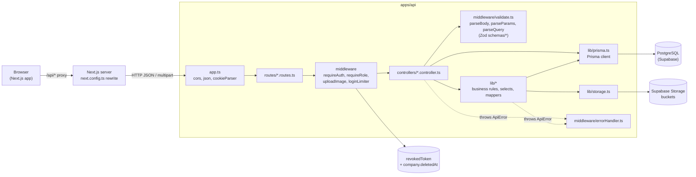
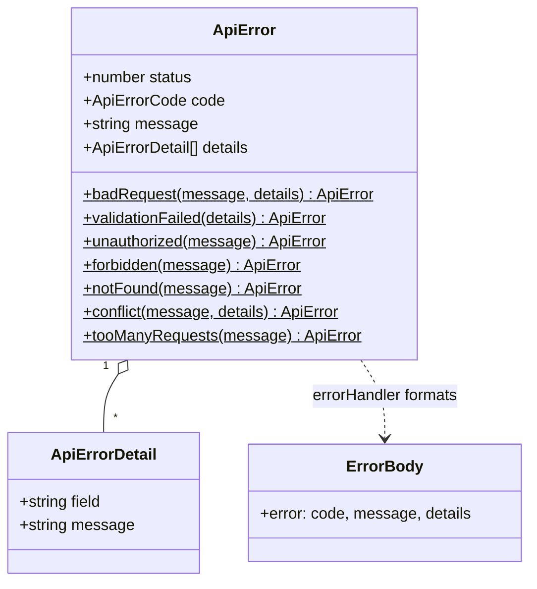
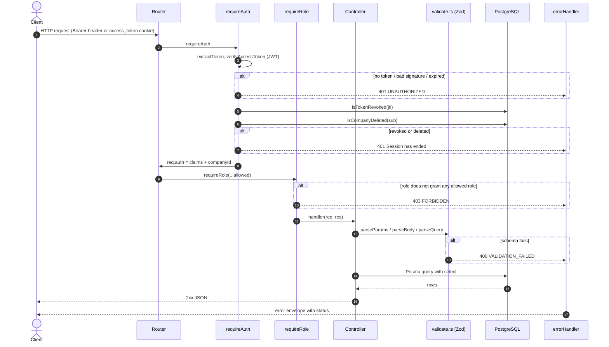
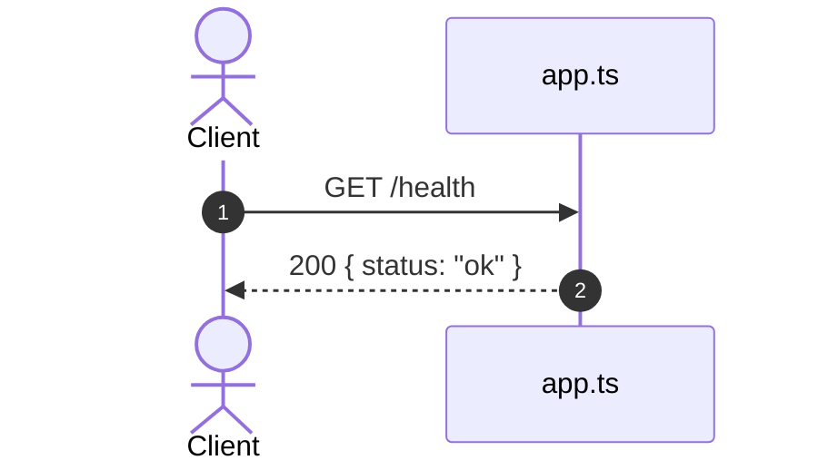

# API UML diagrams

UML diagrams for every endpoint in `apps/api`. They are written in
[Mermaid](https://mermaid.js.org/), so GitHub draws them in the browser. No
tool to install.

Each router has its own page. Each endpoint has one **sequence diagram**: who
calls whom, in what order, and which errors can come back.

| Router       | Mounted at      | Endpoints | Page                               |
| ------------ | --------------- | --------- | ---------------------------------- |
| Health       | `/health`       | 1         | [below](#get-health)               |
| Auth         | `/auth`         | 5         | [auth.md](auth.md)                 |
| Admin        | `/admin`        | 4         | [admin.md](admin.md)               |
| Companies    | `/companies`    | 11        | [companies.md](companies.md)       |
| Services     | `/services`     | 7         | [services.md](services.md)         |
| Portfolios   | `/portfolios`   | 5         | [portfolios.md](portfolios.md)     |
| Certificates | `/certificates` | 5         | [certificates.md](certificates.md) |
| Jobs         | `/jobs`         | 8         | [jobs.md](jobs.md)                 |
| Proposals    | `/proposals`    | 4         | [proposals.md](proposals.md)       |
| Projects     | `/projects`     | 11        | [projects.md](projects.md)         |
| Categories   | `/categories`   | 1         | [categories.md](categories.md)     |

When you add or change an endpoint, update its diagram in the same PR.

## Component diagram

The layers a request passes through. Arrows point from caller to callee.

## Class diagram: error envelope

Every error leaves through `errorHandler` in one shape. The diagrams below
only name the status and the message.

| Status | Code                | When                                                   |
| ------ | ------------------- | ------------------------------------------------------ |
| 400    | `VALIDATION_FAILED` | A Zod schema rejected the body, params, or query       |
| 400    | `BAD_REQUEST`       | A rule that is not a schema rule, e.g. a bad file type |
| 401    | `UNAUTHORIZED`      | No token, bad token, revoked token, deleted company    |
| 403    | `FORBIDDEN`         | Signed in, but the role or the ownership is wrong      |
| 404    | `NOT_FOUND`         | No such row, or the caller may not know it exists      |
| 409    | `CONFLICT`          | The row's state does not allow the action              |
| 429    | `TOO_MANY_REQUESTS` | 10 failed sign-ins for one email in 15 minutes         |

## Shared request pipeline

Most diagrams draw the guards as one step. This is what that step does.

Notes:

- A **BOTH** company passes `requireRole('provider')` and
  `requireRole('receiver')` (`auth/roles.ts`, `roleGrants`).
- Routes with only `requireAuth` check ownership or party inside the handler.
- Paged lists answer `{ items, pagination }`. `count` and `findMany` run in one
  `$transaction` so the numbers match the page.

## GET /health

Public. No database call.

