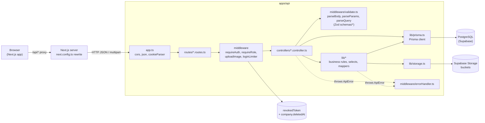
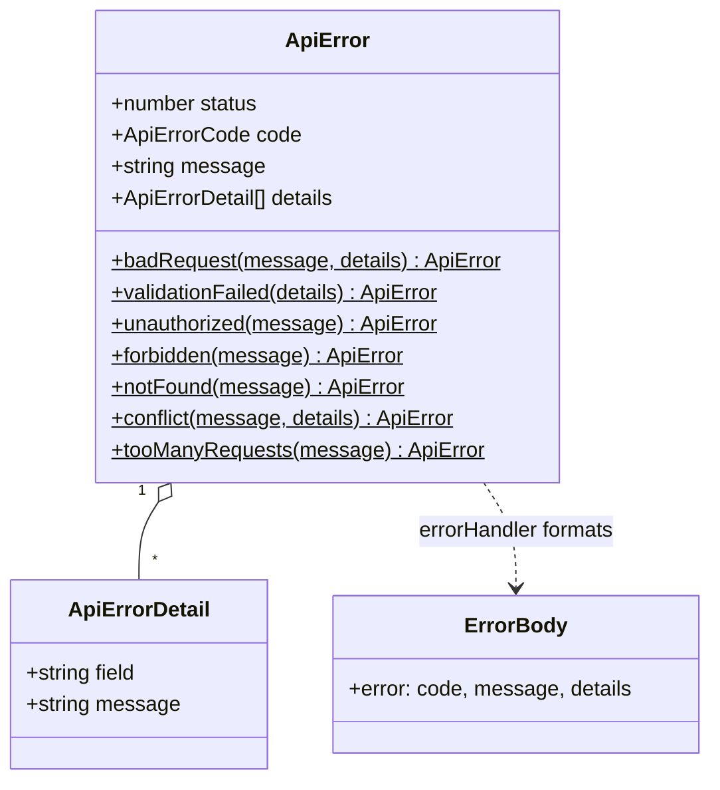
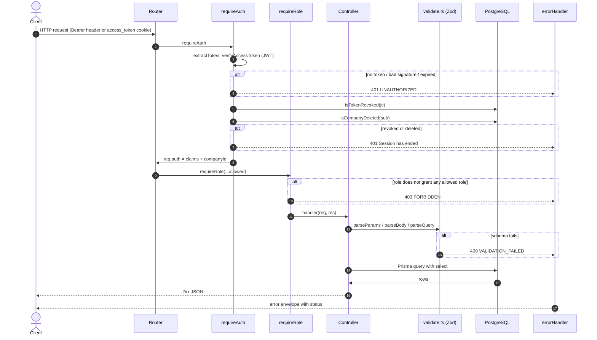
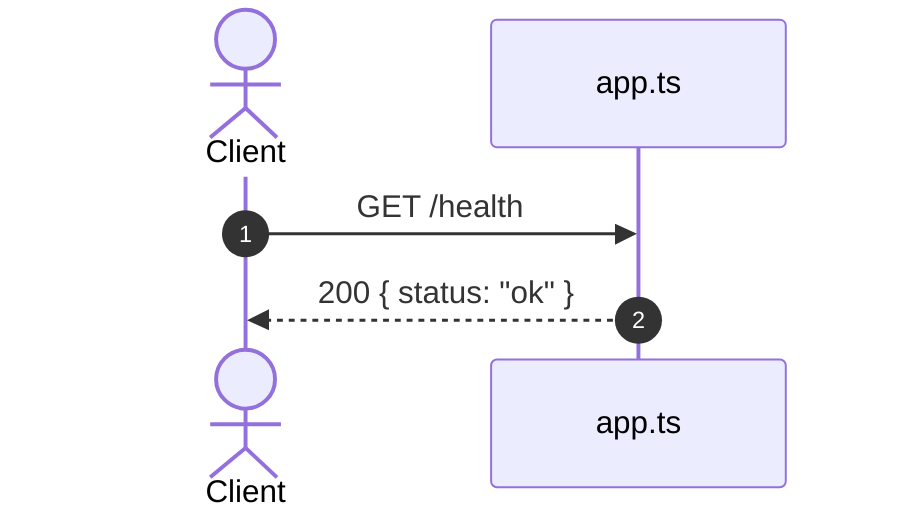

# API UML diagrams

UML diagrams for every endpoint in `apps/api`. They are written in
[Mermaid](https://mermaid.js.org/), so GitHub draws them in the browser. No
tool to install.

Each router has its own page with two kinds of diagram:

1. A **UML API Diagram** (REST profile). It shows the contract: paths,
   operations, parameters, bodies, and status codes.
2. One **sequence diagram** per endpoint. It shows the steps inside the
   server: guards, lib calls, database writes, and where each error comes from.

| Router       | Mounted at      | Endpoints | Page                               |
| ------------ | --------------- | --------- | ---------------------------------- |
| Health       | `/health`       | 1         | [below](#get-health)               |
| Auth         | `/auth`         | 5         | [auth.md](auth.md)                 |
| Admin        | `/admin`        | 4         | [admin.md](admin.md)               |
| Companies    | `/companies`    | 11        | [companies.md](companies.md)       |
| Services     | `/services`     | 7         | [services.md](services.md)         |
| Portfolios   | `/portfolios`   | 5         | [portfolios.md](portfolios.md)     |
| Certificates | `/certificates` | 5         | [certificates.md](certificates.md) |
| Jobs         | `/jobs`         | 8         | [jobs.md](jobs.md)                 |
| Proposals    | `/proposals`    | 4         | [proposals.md](proposals.md)       |
| Projects     | `/projects`     | 11        | [projects.md](projects.md)         |
| Categories   | `/categories`   | 1         | [categories.md](categories.md)     |

When you add or change an endpoint, update its diagram in the same PR.

## UML API Diagram notation

The UML API Diagrams use a REST profile with four stereotypes (the Sparx
Systems style). It is a course convention, not an OMG standard.

| Stereotype         | Colour      | Means                                             | In this API                       |
| ------------------ | ----------- | ------------------------------------------------- | --------------------------------- |
| `«Application»`    | yellow      | The root `/` of the API. Tagged value `basePath`. | One box, `MangoDB API`            |
| `«Path»`           | arrow label | One URI segment. Segments chain from the root.    | `/services`, then `/{serviceId}`  |
| `«Resource»`       | blue        | A thing the API exposes, with its operations      | `+ PATCH(UpdateServiceRequest)`   |
| `«Representation»` | green       | A JSON body sent or returned, joined by `«use»`   | `Service`, `CreateServiceRequest` |

How to read an operation:

- `+ GET(q, page : QueryParam)`: query parameters go in the brackets.
- `+ POST(CreateJobRequest)`: the request body is a `«Representation»`.
- `: 201 | 400 | 409`: every status code the operation can answer.
- A field ending in `?` may be absent or `null`.
- A paged `GET` answers `{ items: Representation[], pagination }`.
- Every route needs a token except `/auth/*` (except logout),
  `GET /portfolios`, `GET /portfolios/{portfolioId}`, `GET /categories`,
  and `GET /health`.
- The browser calls `/api/...`. Next.js strips `/api` and forwards the call,
  so the API itself has `basePath = "/"`.

### Design to code traceability

| Must match              | In the UML API Diagram            | In the source code                                |
| ----------------------- | --------------------------------- | ------------------------------------------------- |
| HTTP method             | operation of a `«Resource»`       | `router.get` / `.post` / `.patch` / `.delete`     |
| URI path                | `«Path»` chain from the root      | `routes.use("/services", ...)` + the route string |
| Path parameter          | `«Path» /{serviceId}`             | `:serviceId` and `parseParams`                    |
| Query parameter         | operation parameter, `QueryParam` | `parseQuery(...Schema, req.query)`                |
| Request / response body | `«Representation»`                | `parseBody` and `res.json(...)`                   |
| Status code             | listed on the operation           | `res.status(201)` and `ApiError`                  |

### Whole API

Every resource and path, without the representations. Each router page has
the full diagram for its part.

```mermaid
classDiagram
    direction LR
    class API["MangoDB API"] {
        <<Application>>
        basePath = "/"
    }
    class Auth["Auth"] {
        <<Resource>>
    }
    class Register["Register"] {
        <<Resource>>
        +POST(RegisterRequest) 201 | 400 | 409
    }
    class Login["Login"] {
        <<Resource>>
        +POST(LoginRequest) 200 | 400 | 401 | 403 | 429
    }
    class AdminAuth["Admin"] {
        <<Resource>>
    }
    class AdminLogin["AdminLogin"] {
        <<Resource>>
        +POST(LoginRequest) 200 | 400 | 401 | 403 | 429
    }
    class CheckAvailability["CheckAvailability"] {
        <<Resource>>
        +POST(IdentityCheck) 200 | 400
    }
    class Logout["Logout"] {
        <<Resource>>
        +POST() 204 | 401
    }
    class Admin["Admin"] {
        <<Resource>>
    }
    class AdminCompanies["Companies"] {
        <<Resource>>
        +GET(page, pageSize, q, filter, includeDeleted : QueryParam) 200 | 400 | 401 | 403
    }
    class AdminCompany["Company"] {
        <<Resource>>
        +GET() 200 | 400 | 401 | 403 | 404
        +PATCH(UpdateCompanyProfileRequest) 200 | 400 | 401 | 403 | 404 | 409
        +DELETE(DeleteCompanyAccountRequest) 204 | 400 | 401 | 403 | 404 | 409
    }
    class Companies["Companies"] {
        <<Resource>>
        +GET(q, orderBy, page, pageSize : QueryParam) 200 | 400 | 401 | 403
    }
    class Me["Me"] {
        <<Resource>>
        +GET() 200 | 401 | 404
        +PATCH(UpdateCompanyProfileRequest) 200 | 400 | 401 | 403 | 404 | 409
        +DELETE() 204 | 401 | 403 | 409
    }
    class Credentials["Credentials"] {
        <<Resource>>
        +PATCH(ChangeCredentialsRequest) 200 | 400 | 401 | 404 | 409
    }
    class Photo["Photo"] {
        <<Resource>>
        +PATCH(PhotoUpload) 200 | 400 | 401 | 404
        +DELETE() 200 | 401 | 404
    }
    class Company["Company"] {
        <<Resource>>
        +GET() 200 | 400 | 401 | 403 | 404
    }
    class CompletedProjects["CompletedProjects"] {
        <<Resource>>
        +GET(page, pageSize : QueryParam) 200 | 400 | 401 | 403 | 404
    }
    class Reviews["Reviews"] {
        <<Resource>>
        +GET(page, pageSize : QueryParam) 200 | 400 | 401 | 403 | 404
    }
    class ReviewSummaryR["ReviewSummary"] {
        <<Resource>>
        +GET() 200 | 400 | 401 | 403 | 404
    }
    class Services["Services"] {
        <<Resource>>
        +GET(q, category, techStack, minPrice, maxPrice, companyId, orderBy, page, pageSize : QueryParam) 200 | 400 | 401 | 403
        +POST(CreateServiceRequest) 201 | 400 | 401 | 403
    }
    class FilterOptions["FilterOptions"] {
        <<Resource>>
        +GET() 200 | 401 | 403
    }
    class MyServices["MyServices"] {
        <<Resource>>
        +GET(status : QueryParam) 200 | 400 | 401 | 403
    }
    class ServiceR["Service"] {
        <<Resource>>
        +GET() 200 | 400 | 401 | 403 | 404
        +PATCH(UpdateServiceRequest) 200 | 400 | 401 | 403 | 404
        +DELETE() 204 | 400 | 401 | 403 | 404 | 409
    }
    class Portfolios["Portfolios"] {
        <<Resource>>
        +GET(serviceId, companyId : QueryParam) 200 | 400
        +POST(CreatePortfolioRequest) 201 | 400 | 401 | 403 | 404 | 409
    }
    class PortfolioR["Portfolio"] {
        <<Resource>>
        +GET() 200 | 400 | 404
        +PATCH(UpdatePortfolioRequest) 200 | 400 | 401 | 403 | 404 | 409
        +DELETE() 204 | 400 | 401 | 403 | 404
    }
    class Certificates["Certificates"] {
        <<Resource>>
        +GET(companyId : QueryParam) 200 | 400 | 401 | 403
        +POST(CertificateRequest) 201 | 400 | 401 | 403
    }
    class MyCertificates["MyCertificates"] {
        <<Resource>>
        +GET() 200 | 401 | 403
    }
    class CertificateR["Certificate"] {
        <<Resource>>
        +PATCH(CertificateRequest) 200 | 400 | 401 | 404
        +DELETE() 204 | 400 | 401 | 404
    }
    class Jobs["Jobs"] {
        <<Resource>>
        +GET(status, companyId, q, category, minBudget, maxBudget, deadline, page, pageSize : QueryParam) 200 | 400 | 401 | 403
        +POST(CreateJobRequest) 201 | 400 | 401 | 403
    }
    class MyJobs["MyJobs"] {
        <<Resource>>
        +GET(status, page, pageSize : QueryParam) 200 | 400 | 401 | 403
    }
    class JobR["Job"] {
        <<Resource>>
        +GET() 200 | 400 | 401 | 403 | 404
        +PATCH(UpdateJobRequest) 200 | 400 | 401 | 403 | 404 | 409
    }
    class CloseJob["Close"] {
        <<Resource>>
        +POST() 200 | 400 | 401 | 403 | 404 | 409
    }
    class JobProposals["JobProposals"] {
        <<Resource>>
        +GET() 200 | 400 | 401 | 403 | 404
        +POST(CreateProposalRequest) 201 | 400 | 401 | 403 | 404 | 409
    }
    class Proposals["Proposals"] {
        <<Resource>>
    }
    class MyProposals["MyProposals"] {
        <<Resource>>
        +GET(status, page, pageSize : QueryParam) 200 | 400 | 401 | 403
    }
    class Counts["Counts"] {
        <<Resource>>
        +GET() 200 | 401 | 403
    }
    class ProposalR["Proposal"] {
        <<Resource>>
    }
    class Accept["Accept"] {
        <<Resource>>
        +POST() 201 | 400 | 401 | 403 | 404 | 409
    }
    class Reject["Reject"] {
        <<Resource>>
        +POST() 204 | 400 | 401 | 403 | 404 | 409
    }
    class Projects["Projects"] {
        <<Resource>>
    }
    class MyProjects["MyProjects"] {
        <<Resource>>
        +GET(page, pageSize : QueryParam) 200 | 400 | 401
    }
    class ProjectR["Project"] {
        <<Resource>>
        +GET() 200 | 400 | 401 | 404
    }
    class Updates["Updates"] {
        <<Resource>>
        +GET() 200 | 400 | 401 | 404
        +POST(CreateProjectUpdateRequest) 201 | 400 | 401 | 403 | 404 | 409
    }
    class ReportDeposit["ReportDeposit"] {
        <<Resource>>
        +POST() 200 | 400 | 401 | 403 | 404 | 409
    }
    class ConfirmDeposit["ConfirmDeposit"] {
        <<Resource>>
        +POST() 200 | 400 | 401 | 403 | 404 | 409
    }
    class SubmitWork["SubmitWork"] {
        <<Resource>>
        +POST() 200 | 400 | 401 | 403 | 404 | 409
    }
    class RejectWork["RejectWork"] {
        <<Resource>>
        +POST(RejectWorkRequest) 200 | 400 | 401 | 403 | 404 | 409
    }
    class AcceptWork["AcceptWork"] {
        <<Resource>>
        +POST() 200 | 400 | 401 | 403 | 404 | 409
    }
    class ReviewR["Review"] {
        <<Resource>>
        +GET() 200 | 400 | 401 | 404
        +POST(CreateReviewRequest) 201 | 400 | 401 | 403 | 404 | 409
    }
    class Categories["Categories"] {
        <<Resource>>
        +GET() 200
    }
    class HealthR["Health"] {
        <<Resource>>
        +GET() 200
    }
    API --> Auth : «Path» /auth
    Auth --> Register : «Path» /register
    Auth --> Login : «Path» /login
    Auth --> AdminAuth : «Path» /admin
    AdminAuth --> AdminLogin : «Path» /login
    Auth --> CheckAvailability : «Path» /check-availability
    Auth --> Logout : «Path» /logout
    API --> Admin : «Path» /admin
    Admin --> AdminCompanies : «Path» /companies
    AdminCompanies --> AdminCompany : «Path» /{companyId}
    API --> Companies : «Path» /companies
    Companies --> Me : «Path» /me
    Me --> Credentials : «Path» /credentials
    Me --> Photo : «Path» /photo
    Companies --> Company : «Path» /{companyId}
    Company --> CompletedProjects : «Path» /completed-projects
    Company --> Reviews : «Path» /reviews
    Reviews --> ReviewSummaryR : «Path» /summary
    API --> Services : «Path» /services
    Services --> FilterOptions : «Path» /filter-options
    Services --> MyServices : «Path» /mine
    Services --> ServiceR : «Path» /{serviceId}
    API --> Portfolios : «Path» /portfolios
    Portfolios --> PortfolioR : «Path» /{portfolioId}
    API --> Certificates : «Path» /certificates
    Certificates --> MyCertificates : «Path» /mine
    Certificates --> CertificateR : «Path» /{certificateId}
    API --> Jobs : «Path» /jobs
    Jobs --> MyJobs : «Path» /mine
    Jobs --> JobR : «Path» /{jobId}
    JobR --> CloseJob : «Path» /close
    JobR --> JobProposals : «Path» /proposals
    API --> Proposals : «Path» /proposals
    Proposals --> MyProposals : «Path» /mine
    MyProposals --> Counts : «Path» /counts
    Proposals --> ProposalR : «Path» /{proposalId}
    ProposalR --> Accept : «Path» /accept
    ProposalR --> Reject : «Path» /reject
    API --> Projects : «Path» /projects
    Projects --> MyProjects : «Path» /mine
    Projects --> ProjectR : «Path» /{projectId}
    ProjectR --> Updates : «Path» /updates
    ProjectR --> ReportDeposit : «Path» /report-deposit
    ProjectR --> ConfirmDeposit : «Path» /confirm-deposit
    ProjectR --> SubmitWork : «Path» /submit-work
    ProjectR --> RejectWork : «Path» /reject-work
    ProjectR --> AcceptWork : «Path» /accept-work
    ProjectR --> ReviewR : «Path» /review
    API --> Categories : «Path» /categories
    API --> HealthR : «Path» /health
    style API fill:#fde68a,stroke:#b45309
    style Auth fill:#bfdbfe,stroke:#1d4ed8
    style Register fill:#bfdbfe,stroke:#1d4ed8
    style Login fill:#bfdbfe,stroke:#1d4ed8
    style AdminAuth fill:#bfdbfe,stroke:#1d4ed8
    style AdminLogin fill:#bfdbfe,stroke:#1d4ed8
    style CheckAvailability fill:#bfdbfe,stroke:#1d4ed8
    style Logout fill:#bfdbfe,stroke:#1d4ed8
    style Admin fill:#bfdbfe,stroke:#1d4ed8
    style AdminCompanies fill:#bfdbfe,stroke:#1d4ed8
    style AdminCompany fill:#bfdbfe,stroke:#1d4ed8
    style Companies fill:#bfdbfe,stroke:#1d4ed8
    style Me fill:#bfdbfe,stroke:#1d4ed8
    style Credentials fill:#bfdbfe,stroke:#1d4ed8
    style Photo fill:#bfdbfe,stroke:#1d4ed8
    style Company fill:#bfdbfe,stroke:#1d4ed8
    style CompletedProjects fill:#bfdbfe,stroke:#1d4ed8
    style Reviews fill:#bfdbfe,stroke:#1d4ed8
    style ReviewSummaryR fill:#bfdbfe,stroke:#1d4ed8
    style Services fill:#bfdbfe,stroke:#1d4ed8
    style FilterOptions fill:#bfdbfe,stroke:#1d4ed8
    style MyServices fill:#bfdbfe,stroke:#1d4ed8
    style ServiceR fill:#bfdbfe,stroke:#1d4ed8
    style Portfolios fill:#bfdbfe,stroke:#1d4ed8
    style PortfolioR fill:#bfdbfe,stroke:#1d4ed8
    style Certificates fill:#bfdbfe,stroke:#1d4ed8
    style MyCertificates fill:#bfdbfe,stroke:#1d4ed8
    style CertificateR fill:#bfdbfe,stroke:#1d4ed8
    style Jobs fill:#bfdbfe,stroke:#1d4ed8
    style MyJobs fill:#bfdbfe,stroke:#1d4ed8
    style JobR fill:#bfdbfe,stroke:#1d4ed8
    style CloseJob fill:#bfdbfe,stroke:#1d4ed8
    style JobProposals fill:#bfdbfe,stroke:#1d4ed8
    style Proposals fill:#bfdbfe,stroke:#1d4ed8
    style MyProposals fill:#bfdbfe,stroke:#1d4ed8
    style Counts fill:#bfdbfe,stroke:#1d4ed8
    style ProposalR fill:#bfdbfe,stroke:#1d4ed8
    style Accept fill:#bfdbfe,stroke:#1d4ed8
    style Reject fill:#bfdbfe,stroke:#1d4ed8
    style Projects fill:#bfdbfe,stroke:#1d4ed8
    style MyProjects fill:#bfdbfe,stroke:#1d4ed8
    style ProjectR fill:#bfdbfe,stroke:#1d4ed8
    style Updates fill:#bfdbfe,stroke:#1d4ed8
    style ReportDeposit fill:#bfdbfe,stroke:#1d4ed8
    style ConfirmDeposit fill:#bfdbfe,stroke:#1d4ed8
    style SubmitWork fill:#bfdbfe,stroke:#1d4ed8
    style RejectWork fill:#bfdbfe,stroke:#1d4ed8
    style AcceptWork fill:#bfdbfe,stroke:#1d4ed8
    style ReviewR fill:#bfdbfe,stroke:#1d4ed8
    style Categories fill:#bfdbfe,stroke:#1d4ed8
    style HealthR fill:#bfdbfe,stroke:#1d4ed8
```

## Component diagram

The layers a request passes through. Arrows point from caller to callee.

## Class diagram: error envelope

Every error leaves through `errorHandler` in one shape. The diagrams below
only name the status and the message.

| Status | Code                | When                                                   |
| ------ | ------------------- | ------------------------------------------------------ |
| 400    | `VALIDATION_FAILED` | A Zod schema rejected the body, params, or query       |
| 400    | `BAD_REQUEST`       | A rule that is not a schema rule, e.g. a bad file type |
| 401    | `UNAUTHORIZED`      | No token, bad token, revoked token, deleted company    |
| 403    | `FORBIDDEN`         | Signed in, but the role or the ownership is wrong      |
| 404    | `NOT_FOUND`         | No such row, or the caller may not know it exists      |
| 409    | `CONFLICT`          | The row's state does not allow the action              |
| 429    | `TOO_MANY_REQUESTS` | 10 failed sign-ins for one email in 15 minutes         |

## Shared request pipeline

Most diagrams draw the guards as one step. This is what that step does.

Notes:

- A **BOTH** company passes `requireRole('provider')` and
  `requireRole('receiver')` (`auth/roles.ts`, `roleGrants`).
- Routes with only `requireAuth` check ownership or party inside the handler.
- Paged lists answer `{ items, pagination }`. `count` and `findMany` run in one
  `$transaction` so the numbers match the page.

## GET /health

Public. No database call.

