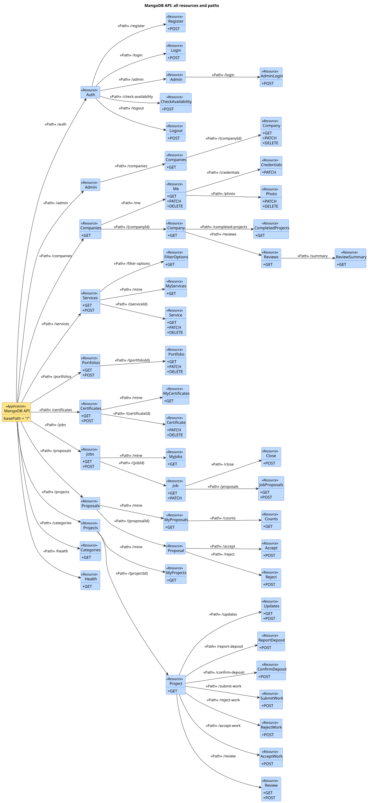
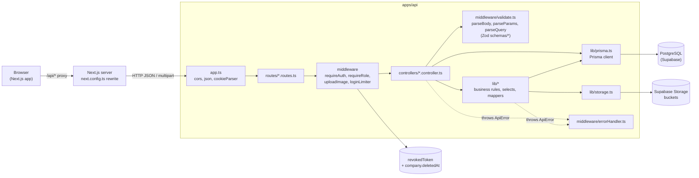
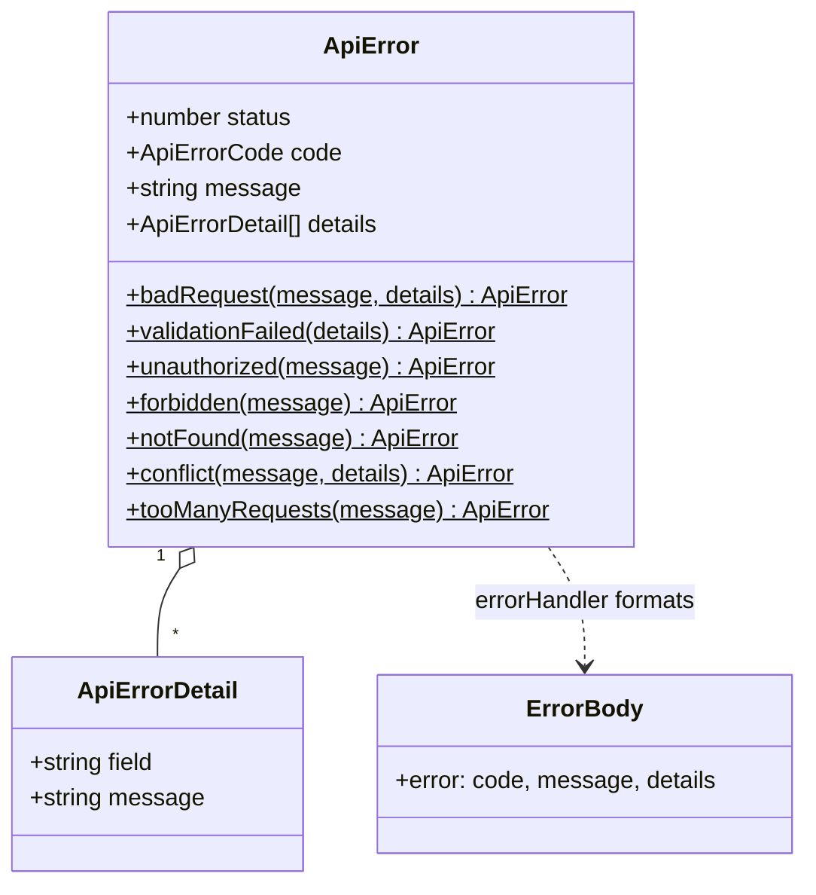
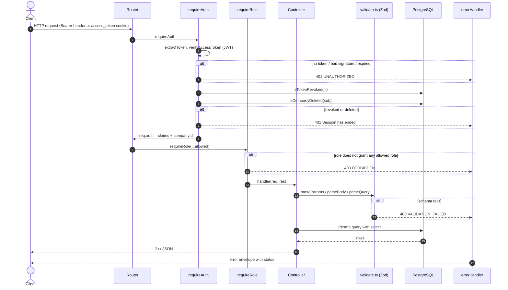
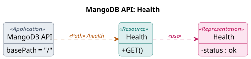
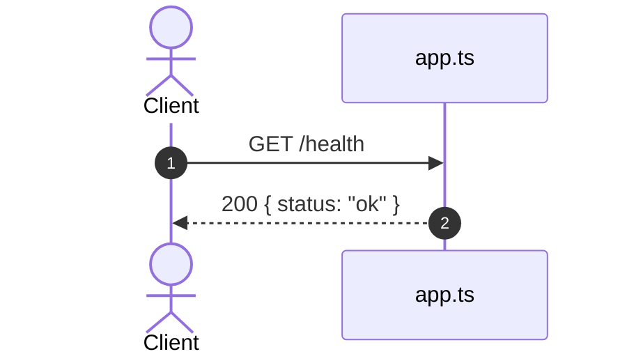

# API docs: UML and OpenAPI

Design docs for every endpoint in `apps/api`, in the three forms the SE lab
uses. The same endpoint is written three ways, and all three must change
together:

| Code (Express)                   | UML API Diagram                     | OpenAPI (Swagger)          |
| -------------------------------- | ----------------------------------- | -------------------------- |
| `jobRoutes.get("/:jobId", ...)`  | `«Resource» Job` with `+ GET`       | `/jobs/{jobId}:` `get:`    |
| `req.params.jobId`               | `«Path» /{jobId}`                   | `parameters:` `in: path`   |
| `req.query.status`               | (OpenAPI only)                      | `parameters:` `in: query`  |
| `req.body`, `res.json(...)`      | `«Representation» Job`              | `#/components/schemas/Job` |
| `res.status(404)`, `ApiError`    | (OpenAPI only)                      | `responses:` `'404':`      |
| `routes.use("/jobs", jobRoutes)` | `«Path» /jobs` from `«Application»` | the path key `/jobs`       |

1. **UML API Diagram** (PlantUML, `uml/*.puml`): the structure. Paths,
   resources, operations, representations.
2. **OpenAPI** (`@openapi` comments above each route in
   `apps/api/src/routes/`, shared schemas in `apps/api/src/openapi.ts`): the
   details. Parameters, bodies, status codes. Swagger UI shows it.
3. **Sequence diagrams** (Mermaid, on each router page): the steps inside the
   server for each endpoint.

| Router       | Mounted at      | Endpoints | Page                               | UML                                        |
| ------------ | --------------- | --------- | ---------------------------------- | ------------------------------------------ |
| Health       | `/health`       | 1         | [below](#get-health)               | [health.puml](uml/health.puml)             |
| Auth         | `/auth`         | 5         | [auth.md](auth.md)                 | [auth.puml](uml/auth.puml)                 |
| Admin        | `/admin`        | 4         | [admin.md](admin.md)               | [admin.puml](uml/admin.puml)               |
| Companies    | `/companies`    | 11        | [companies.md](companies.md)       | [companies.puml](uml/companies.puml)       |
| Services     | `/services`     | 9         | [services.md](services.md)         | [services.puml](uml/services.puml)         |
| Portfolios   | `/portfolios`   | 5         | [portfolios.md](portfolios.md)     | [portfolios.puml](uml/portfolios.puml)     |
| Certificates | `/certificates` | 5         | [certificates.md](certificates.md) | [certificates.puml](uml/certificates.puml) |
| Jobs         | `/jobs`         | 8         | [jobs.md](jobs.md)                 | [jobs.puml](uml/jobs.puml)                 |
| Proposals    | `/proposals`    | 4         | [proposals.md](proposals.md)       | [proposals.puml](uml/proposals.puml)       |
| Projects     | `/projects`     | 14        | [projects.md](projects.md)         | [projects.puml](uml/projects.puml)         |
| Quotations   | `/quotations`   | 3         | [quotations.md](quotations.md)     | [quotations.puml](uml/quotations.puml)     |
| Categories   | `/categories`   | 1         | [categories.md](categories.md)     | [categories.puml](uml/categories.puml)     |

When you add or change an endpoint, update its `.puml` (and `.svg`), its
`@openapi` block, and its sequence diagram in the same PR.

## How to see them

**UML API Diagrams.** Each `.puml` has a matching `.svg` next to it, so
GitHub and the router pages show the picture. To edit one:

- VS Code: install the **PlantUML** extension (jebbs.plantuml, needs Java),
  open a `.puml` file, and press `Alt+D` for the preview.
- Or paste the file into www.plantuml.com/plantuml and press Submit.

After an edit, update the `.svg` too. In VS Code: right-click in the file,
choose **Export Current Diagram**, then SVG. Or from a terminal, with the jar
the extension ships:

```bash
java -jar ~/.vscode/extensions/jebbs.plantuml-*/plantuml.jar -tsvg docs/api/uml/*.puml
```

**OpenAPI / Swagger UI.** Start the API (`npm run dev --workspace apps/api`)
and open http://localhost:4000/api-docs. The raw document is at
http://localhost:4000/openapi.json.

To try an endpoint that needs a session: run `POST /auth/login` with
**Try it out**, copy `accessToken` from the response, press **Authorize**,
paste it, then try any endpoint. Every request goes to the shared database, so
prefer GET requests and test accounts.

## UML API Diagram

The UML API Diagrams use a REST profile with four stereotypes (the Sparx
Systems style from the lecture). It is a course convention, not an OMG
standard.

| Stereotype         | Colour | Arrow                 | Means                                          | In this API                       |
| ------------------ | ------ | --------------------- | ---------------------------------------------- | --------------------------------- |
| `«Application»`    | yellow |                       | The root of the API. Tagged value `basePath`.  | One box, `MangoDB API`            |
| `«Path»`           |        | solid, `-->`          | One URI segment. Segments chain from the root. | `/services`, then `/{serviceId}`  |
| `«Resource»`       | blue   |                       | A thing the API exposes, with its HTTP methods | `Services` with `+ GET` `+ POST`  |
| `«Representation»` | green  | dashed `«use»`, `..>` | A JSON body sent or returned                   | `Service`, `CreateServiceRequest` |

Notes:

- A collection and one member are two resources, like `Items` and `Item` in
  the lab: `Services` at `/services` and `Service` at `/{serviceId}`.
- An action that is not plain CRUD is its own resource with `+ POST`, like
  `Close` at `/jobs/{jobId}/close`. The lecture calls POST the fallback verb.
- A field ending in `?` may be absent or `null`.
- The browser calls `/api/...`. Next.js strips `/api` and forwards the call,
  so the API itself has `basePath = "/"`.

### Whole API

Every resource and path, without the representations. Each router page has
the full diagram for its part. Source:
[uml/mangodb-api.puml](uml/mangodb-api.puml).



## Component diagram

The layers a request passes through. Arrows point from caller to callee.



## Class diagram: error envelope

Every error leaves through `errorHandler` in one shape. The diagrams below
only name the status and the message.



| Status | Code                | When                                                   |
| ------ | ------------------- | ------------------------------------------------------ |
| 400    | `VALIDATION_FAILED` | A Zod schema rejected the body, params, or query       |
| 400    | `BAD_REQUEST`       | A rule that is not a schema rule, e.g. a bad file type |
| 401    | `UNAUTHORIZED`      | No token, bad token, revoked token, deleted company    |
| 403    | `FORBIDDEN`         | Signed in, but the role or the ownership is wrong      |
| 404    | `NOT_FOUND`         | No such row, or the caller may not know it exists      |
| 409    | `CONFLICT`          | The row's state does not allow the action              |
| 429    | `TOO_MANY_REQUESTS` | 10 failed sign-ins for one email in 15 minutes         |

## Shared request pipeline

Most diagrams draw the guards as one step. This is what that step does.



Notes:

- A **BOTH** company passes `requireRole('provider')` and
  `requireRole('receiver')` (`auth/roles.ts`, `roleGrants`).
- Routes with only `requireAuth` check ownership or party inside the handler.
- Paged lists answer `{ items, pagination }`. `count` and `findMany` run in one
  `$transaction` so the numbers match the page.

## GET /health

Public. No database call.




