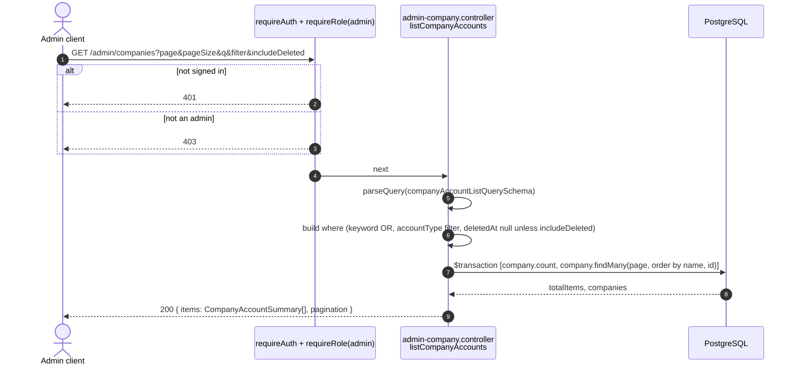
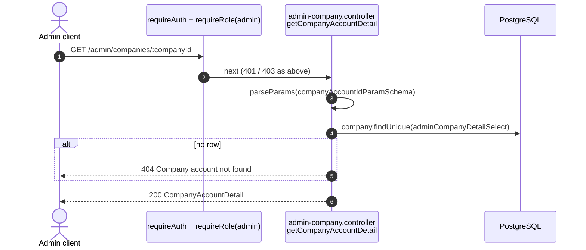
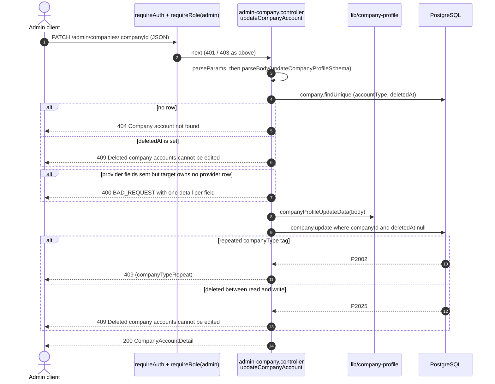
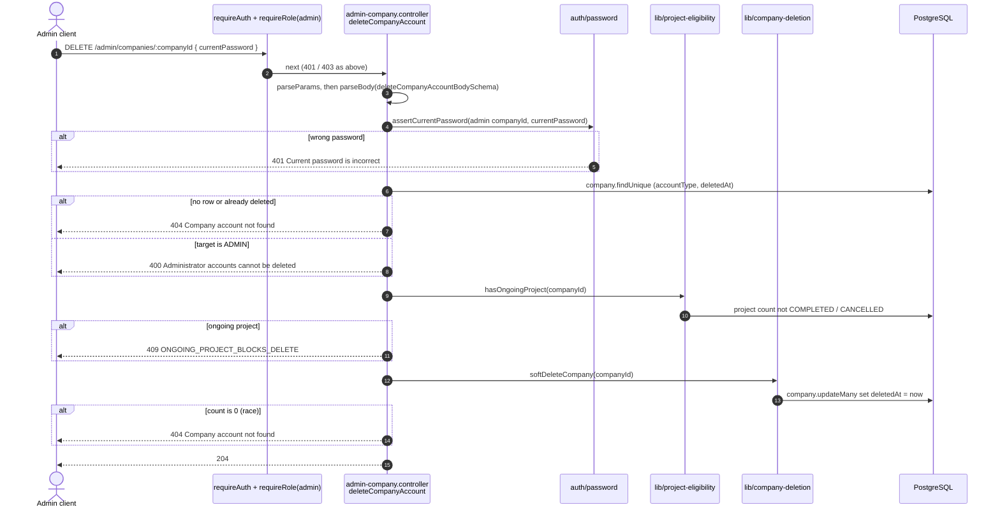

# Admin endpoints (`/admin`)

Source: `apps/api/src/routes/admin.routes.ts`,
`apps/api/src/controllers/admin-company.controller.ts`.
Back to the [index](README.md).

The whole router is guarded once with `requireAuth, requireRole('admin')`.
A company token gets 403 on every route here.

| Method | Path                          | Success                     |
| ------ | ----------------------------- | --------------------------- |
| GET    | `/admin/companies`            | 200 `{ items, pagination }` |
| GET    | `/admin/companies/:companyId` | 200 account detail          |
| PATCH  | `/admin/companies/:companyId` | 200 account detail          |
| DELETE | `/admin/companies/:companyId` | 204                         |

## GET /admin/companies

US6-2. One alphabetical page of company accounts. Admin rows are never listed.

## GET /admin/companies/:companyId

US6-2. One account with its private contact fields.

## PATCH /admin/companies/:companyId

US6-3. Edit profile columns only. Username, email, and password are not
editable here.

## DELETE /admin/companies/:companyId

US6-4. Soft delete. The admin types their own password first.

