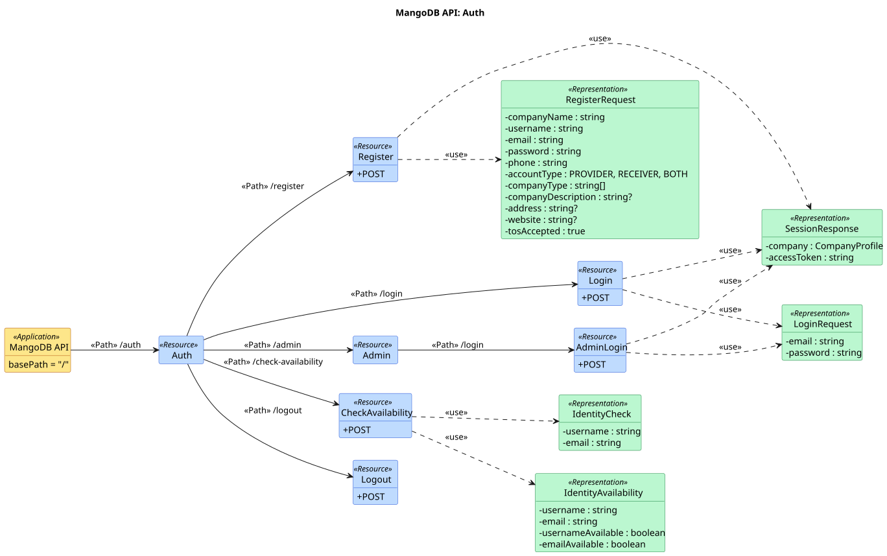
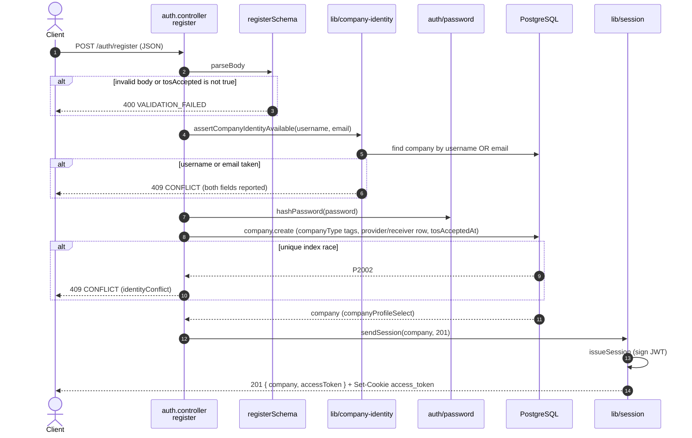
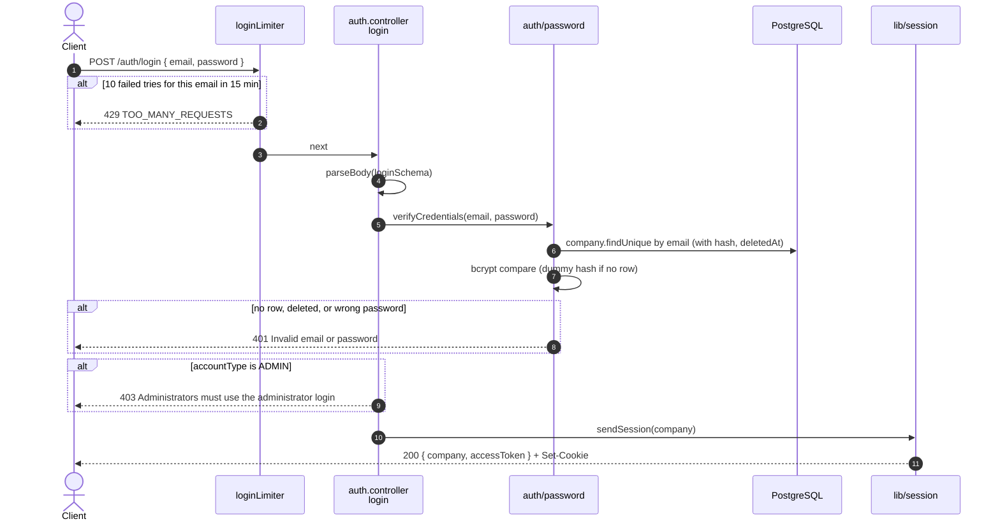
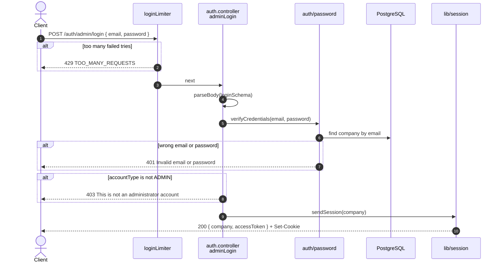
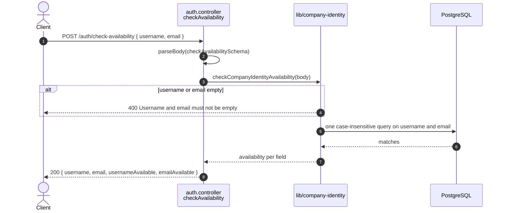
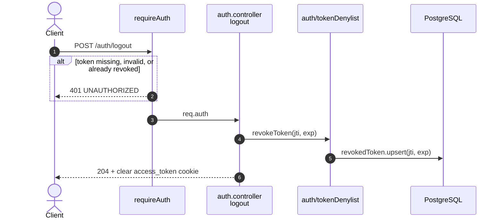

# Auth endpoints (`/auth`)

Source: `apps/api/src/routes/auth.routes.ts`,
`apps/api/src/controllers/auth.controller.ts`.
Back to the [index](README.md).

| Method | Path                       | Guards         | Success                                                      |
| ------ | -------------------------- | -------------- | ------------------------------------------------------------ |
| POST   | `/auth/register`           | public         | 201 `{ company, accessToken }` + cookie                      |
| POST   | `/auth/login`              | `loginLimiter` | 200 `{ company, accessToken }` + cookie                      |
| POST   | `/auth/admin/login`        | `loginLimiter` | 200 `{ company, accessToken }` + cookie                      |
| POST   | `/auth/check-availability` | public         | 200 `{ username, email, usernameAvailable, emailAvailable }` |
| POST   | `/auth/logout`             | `requireAuth`  | 204, cookie cleared                                          |

## UML API Diagram

Source: [uml/auth.puml](uml/auth.puml). REST profile notation, see the [index](README.md#uml-api-diagram). Status codes, parameters and bodies are in the OpenAPI docs at `/api-docs`.

The sections below add one sequence diagram per endpoint: the steps inside the server.

## POST /auth/register

US1-1. Creates the company, its industry tags, and its provider and/or receiver
row in one nested create.

## POST /auth/login

US1-2. Company sign-in. Admins are sent to the admin door.

## POST /auth/admin/login

US6-1. Same as login, but only admins pass.

## POST /auth/check-availability

US1-1.9. Feeds the inline hint on the sign-up form.

## POST /auth/logout

US1-3. Revokes the token's `jti`. A second logout with the same token is 401.

