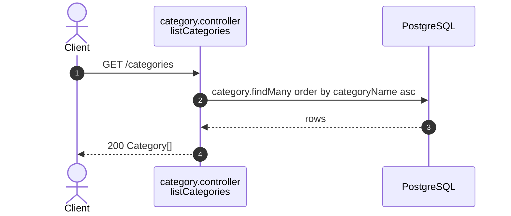

# Category endpoints (`/categories`)

Source: `apps/api/src/routes/category.routes.ts`,
`apps/api/src/controllers/category.controller.ts`.
Back to the [index](README.md).

| Method | Path          | Guards | Success        |
| ------ | ------------- | ------ | -------------- |
| GET    | `/categories` | public | 200 Category[] |

## GET /categories

Public. The fixed catalog a listing picks from (ADR 0002), sorted by name.

