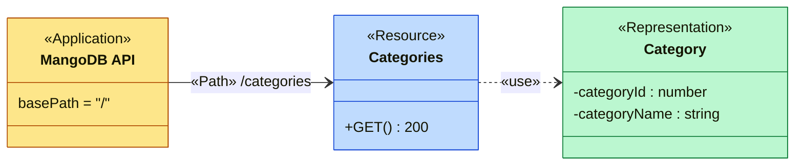
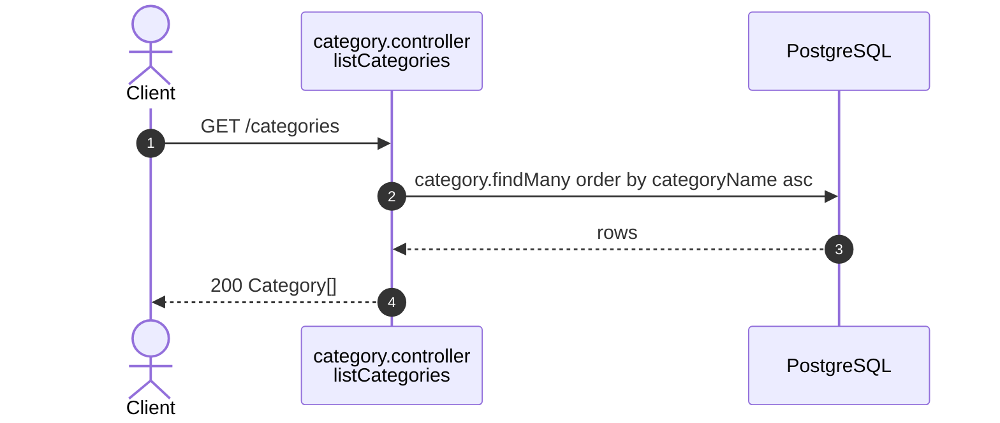

# Category endpoints (`/categories`)

Source: `apps/api/src/routes/category.routes.ts`,
`apps/api/src/controllers/category.controller.ts`.
Back to the [index](README.md).

| Method | Path          | Guards | Success        |
| ------ | ------------- | ------ | -------------- |
| GET    | `/categories` | public | 200 Category[] |

## UML API Diagram

REST profile notation (see the [index](README.md#uml-api-diagram-notation)). Each operation lists its status codes. Follow an arrow from `«Application»` to a `«Resource»` to read one HTTP call.

The sections below add one sequence diagram per endpoint: the steps inside the server.

## GET /categories

Public. The fixed catalog a listing picks from (ADR 0002), sorted by name.

