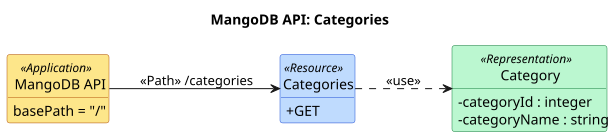
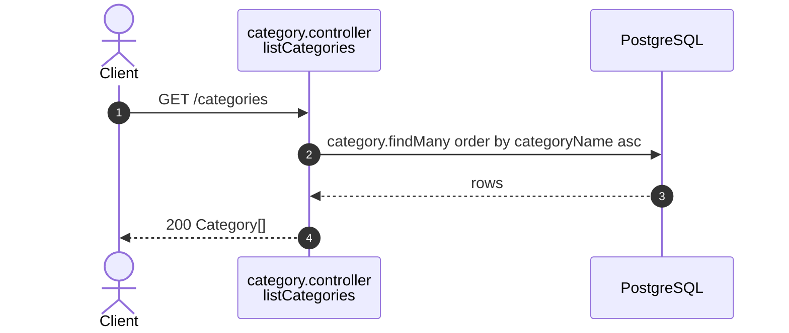

# Category endpoints (`/categories`)

Source: `apps/api/src/routes/category.routes.ts`,
`apps/api/src/controllers/category.controller.ts`.
Back to the [index](README.md).

| Method | Path          | Guards | Success        |
| ------ | ------------- | ------ | -------------- |
| GET    | `/categories` | public | 200 Category[] |

## UML API Diagram

Source: [uml/categories.puml](uml/categories.puml). REST profile notation, see the [index](README.md#uml-api-diagram). Status codes, parameters and bodies are in the OpenAPI docs at `/api-docs`.

The sections below add one sequence diagram per endpoint: the steps inside the server.

## GET /categories

Public. The fixed catalog a listing picks from (ADR 0002), sorted by name.

