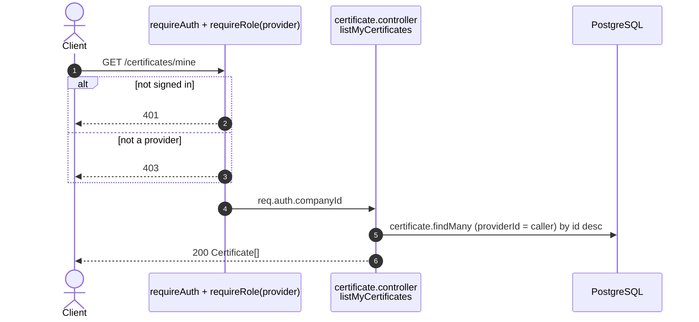
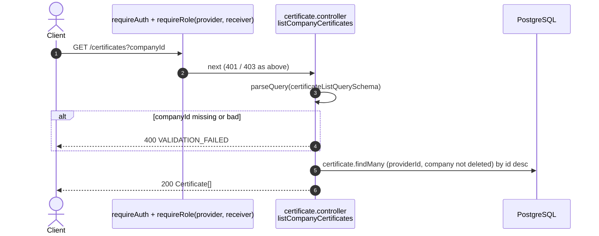
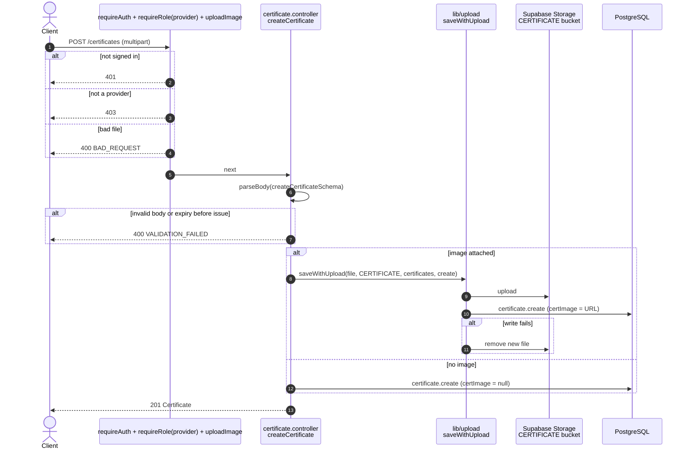
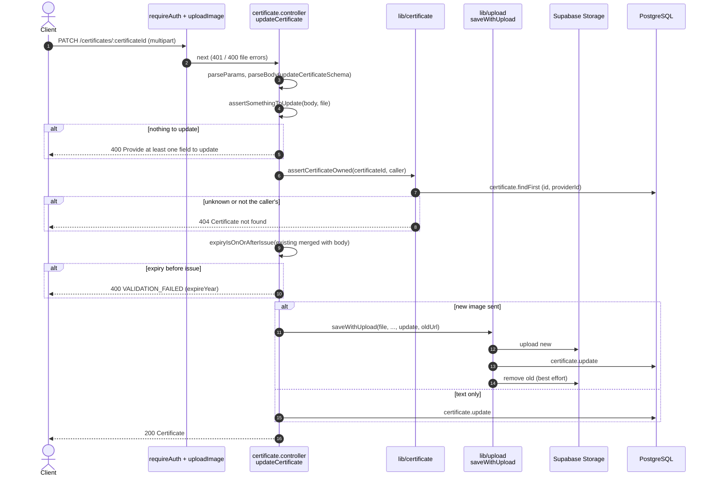
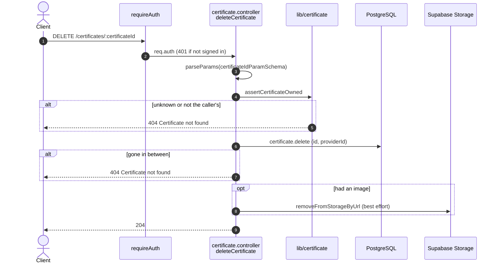

# Certificate endpoints (`/certificates`)

Source: `apps/api/src/routes/certificate.routes.ts`,
`apps/api/src/controllers/certificate.controller.ts`.
Back to the [index](README.md).

A certificate belongs to a provider. The image is optional.

| Method | Path                           | Guards                                  | Success           |
| ------ | ------------------------------ | --------------------------------------- | ----------------- |
| GET    | `/certificates/mine`           | provider                                | 200 Certificate[] |
| GET    | `/certificates?companyId=`     | provider, receiver                      | 200 Certificate[] |
| POST   | `/certificates`                | provider, `uploadImage('certImage')`    | 201 Certificate   |
| PATCH  | `/certificates/:certificateId` | auth, owner, `uploadImage('certImage')` | 200 Certificate   |
| DELETE | `/certificates/:certificateId` | auth, owner                             | 204               |

## GET /certificates/mine

The caller's own certificates, newest first.

## GET /certificates?companyId=

One company's certificates, for its profile page. Unknown, deleted, or
non-provider companies give an empty list, not 404.

## POST /certificates

Multipart. With an image, the file is removed again if the row cannot be
created.

## PATCH /certificates/:certificateId

Owner only. The issue/expiry rule is checked on the merged old and new values.

## DELETE /certificates/:certificateId

Owner only. Hard delete, then remove the image file if any.

