# Company endpoints (`/companies`)

Source: `apps/api/src/routes/company.routes.ts`,
`apps/api/src/controllers/company.controller.ts`
(`completed-projects` lives in `project.controller.ts`).
Back to the [index](README.md).

Every route needs `requireAuth`. "Company" in the guard column means
`requireRole('provider', 'receiver')`: any company, not admins.

| Method | Path                                       | Guards                       | Success                                 |
| ------ | ------------------------------------------ | ---------------------------- | --------------------------------------- |
| GET    | `/companies`                               | company                      | 200 `{ items, pagination }`             |
| GET    | `/companies/me`                            | auth                         | 200 CompanyProfile                      |
| PATCH  | `/companies/me`                            | auth                         | 200 CompanyProfile                      |
| PATCH  | `/companies/me/credentials`                | auth                         | 200 `{ company, accessToken }` + cookie |
| PATCH  | `/companies/me/photo`                      | auth, `uploadImage('photo')` | 200 CompanyProfile                      |
| DELETE | `/companies/me/photo`                      | auth                         | 200 CompanyProfile                      |
| DELETE | `/companies/me`                            | company                      | 204                                     |
| GET    | `/companies/:companyId/completed-projects` | company                      | 200 `{ items, pagination }`             |
| GET    | `/companies/:companyId/reviews`            | company                      | 200 `{ items, pagination }`             |
| GET    | `/companies/:companyId/reviews/summary`    | company                      | 200 rating summary                      |
| GET    | `/companies/:companyId`                    | company                      | 200 PublicCompanyProfile                |

## UML API Diagram

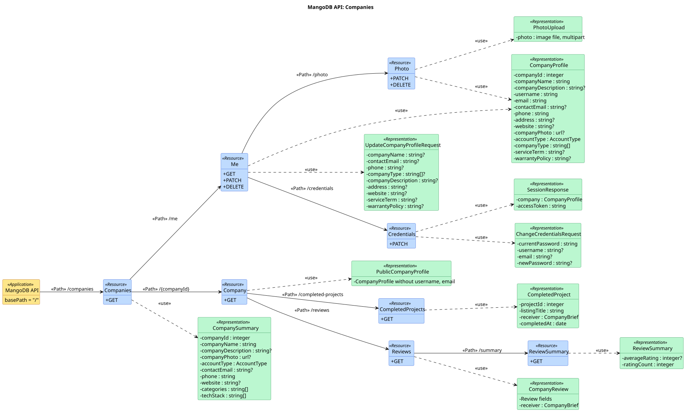

Source: [uml/companies.puml](uml/companies.puml). REST profile notation, see the [index](README.md#uml-api-diagram). Status codes, parameters and bodies are in the OpenAPI docs at `/api-docs`.

The sections below add one sequence diagram per endpoint: the steps inside the server.

## GET /companies

T3.6.7. Company search. Each word must match. Admins and deleted companies are
hidden.

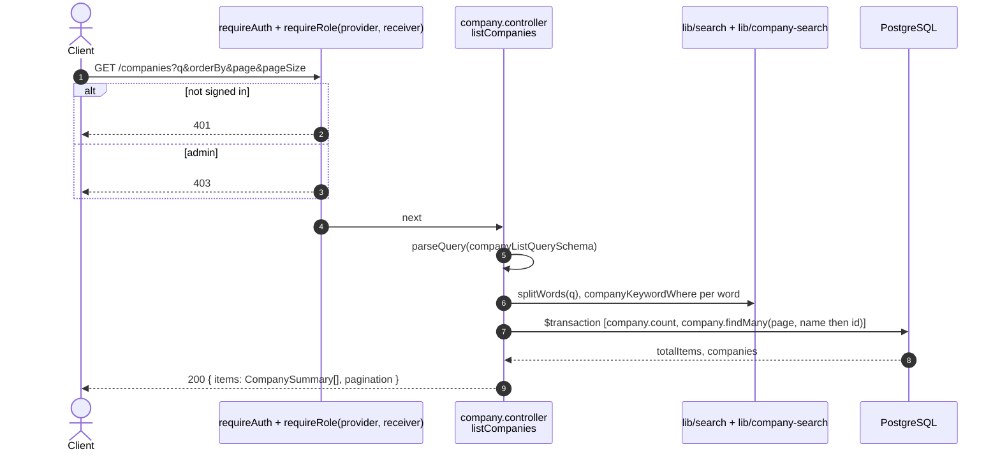

## GET /companies/me

US1-4. The caller's own profile, read fresh from the database.

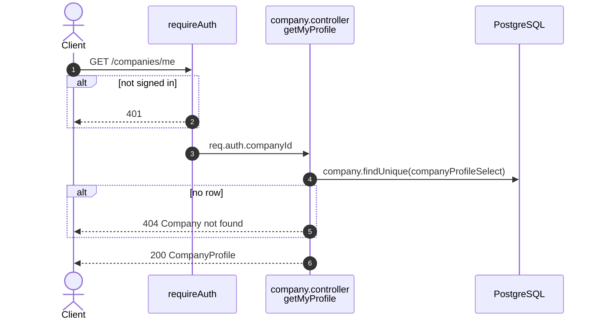

## PATCH /companies/me

US1-5. Partial update. Absent field = no change, `null` = clear.

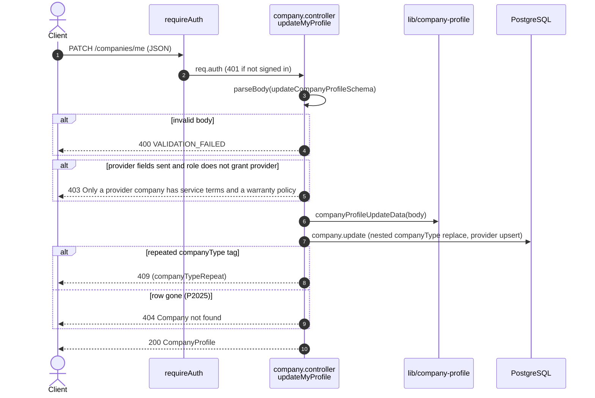

## PATCH /companies/me/credentials

Username, email, and password. Needs the current password. Issues a new token
and revokes the old one.

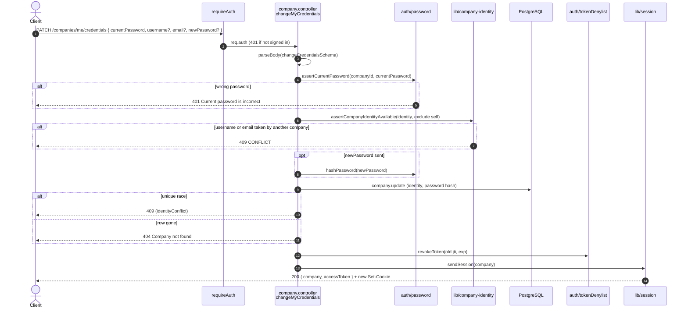

## PATCH /companies/me/photo

US1-5, photo half. Multipart with one file field `photo`.

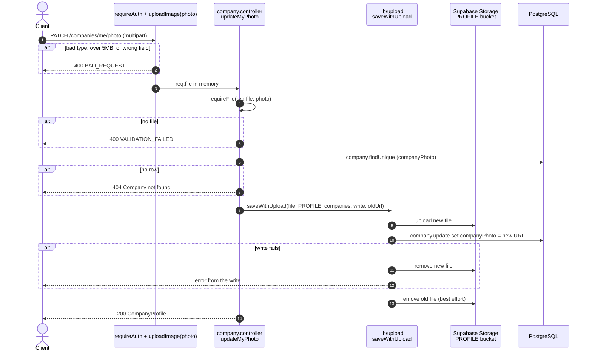

## DELETE /companies/me/photo

Clears the photo. The file is removed after the column is cleared.

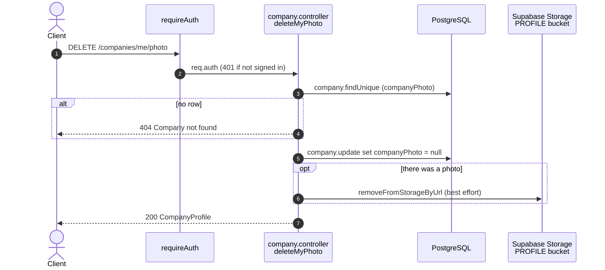

## DELETE /companies/me

US1-6. A company deletes itself (soft delete). Admins cannot use this route.

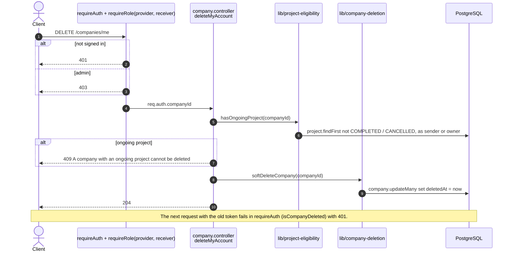

## GET /companies/:companyId/completed-projects

US2-5. A Provider's completed projects, newest first. Paged.

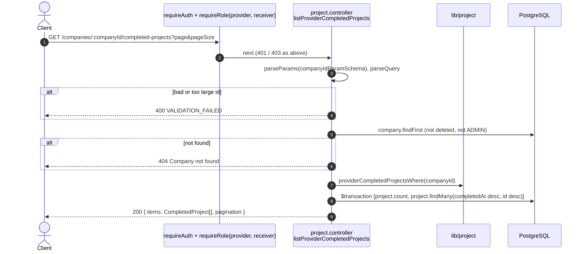

## GET /companies/:companyId/reviews

US5-3. Reviews on a Provider's completed projects, newest first. Paged.

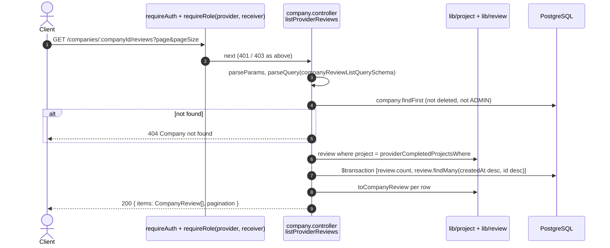

## GET /companies/:companyId/reviews/summary

US5-3. Average score and review count.

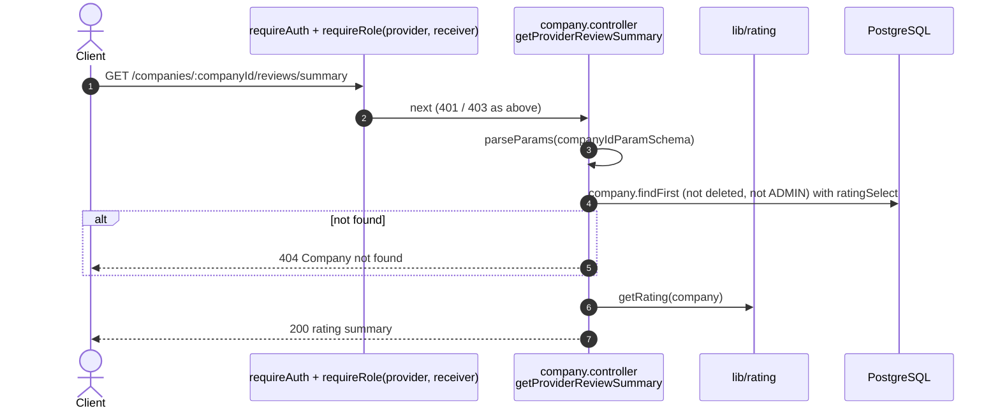

## GET /companies/:companyId

Another company's public profile, without username and email. Unknown,
deleted, and admin ids all answer the same 404.

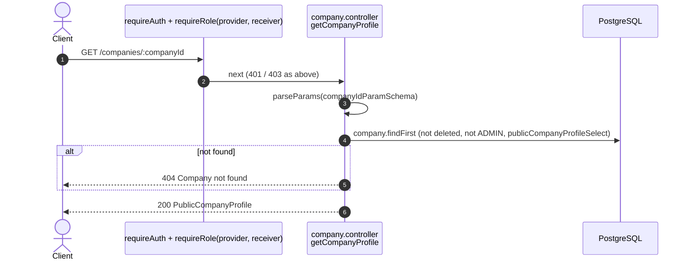
