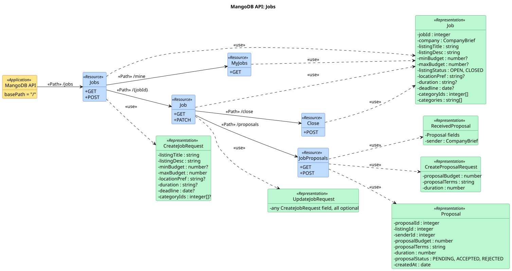
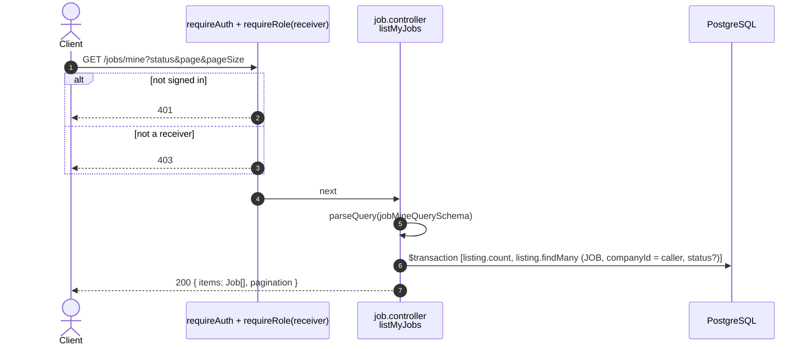
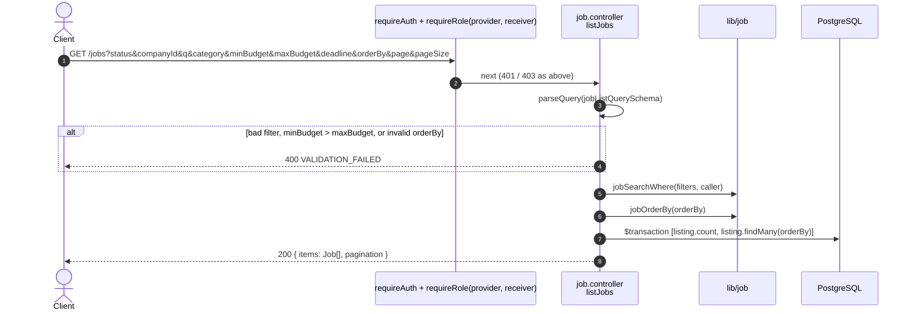
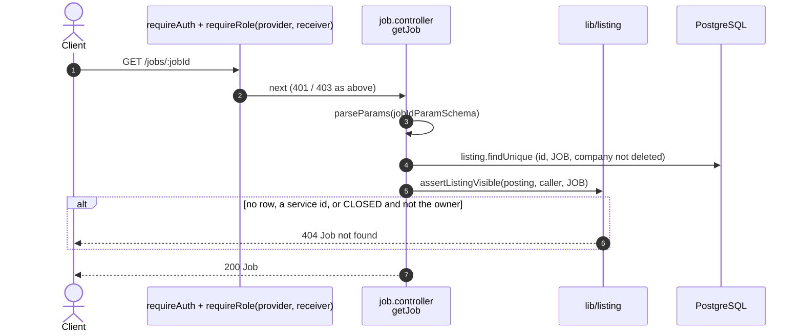
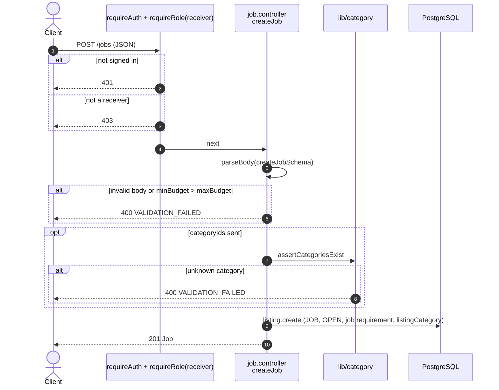
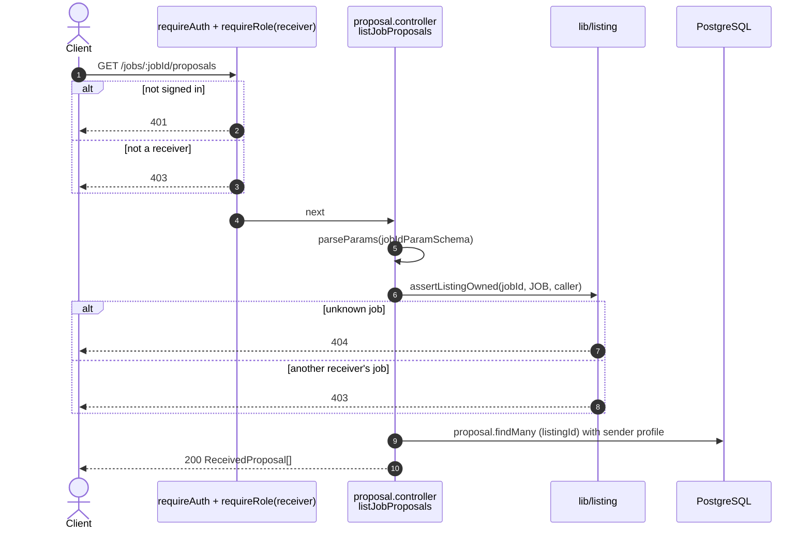
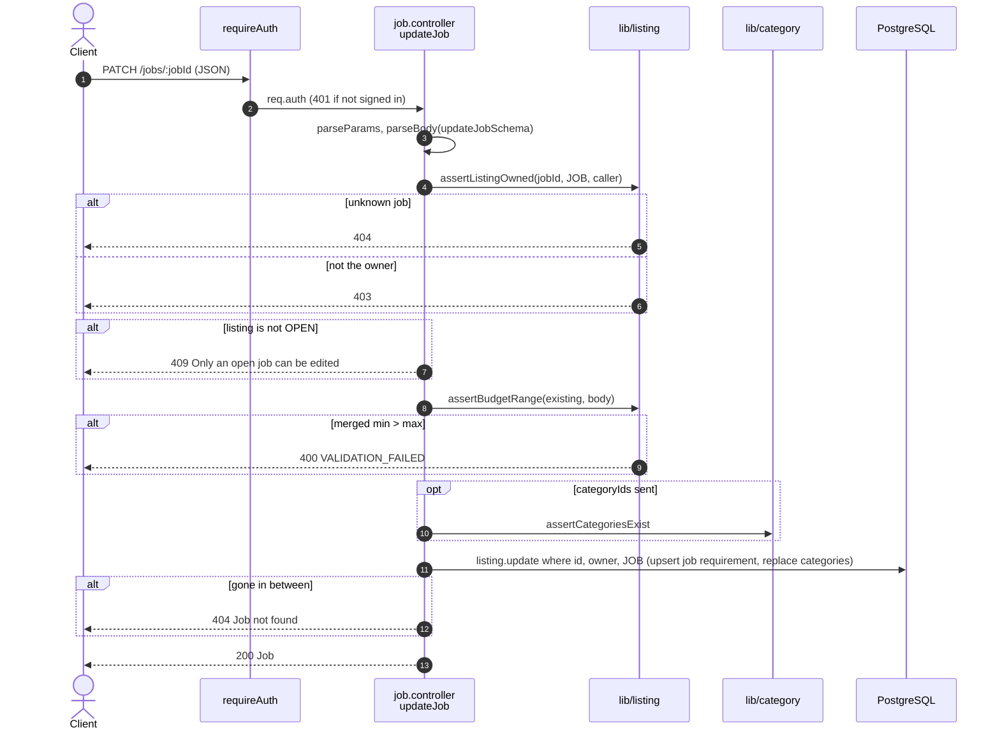
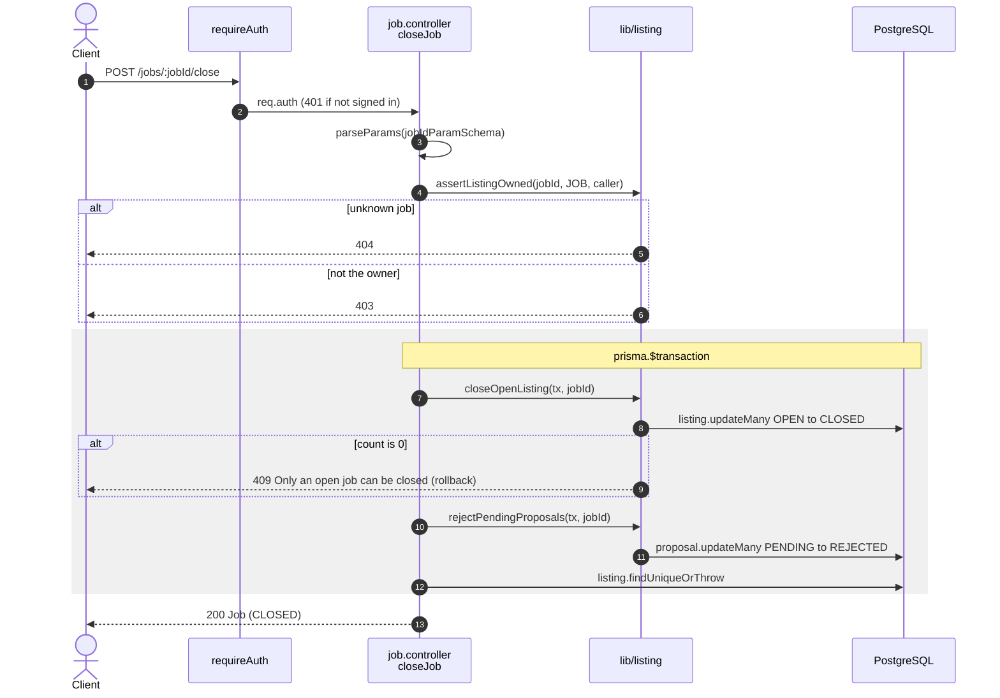
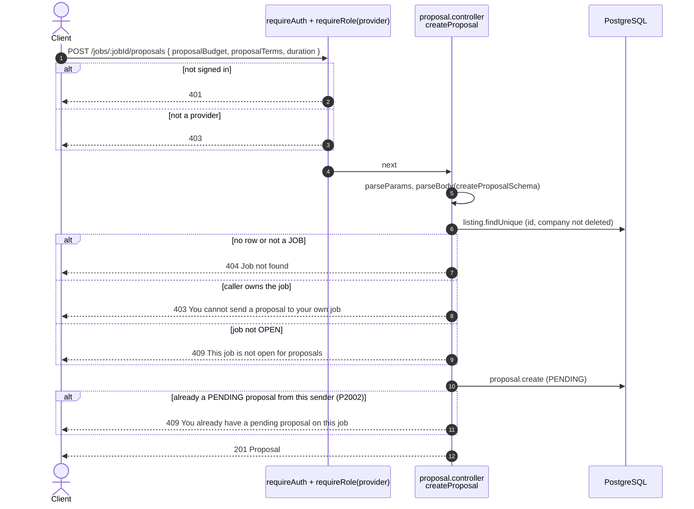

# Job endpoints (`/jobs`)

Source: `apps/api/src/routes/job.routes.ts`,
`apps/api/src/controllers/job.controller.ts`
(the two `/proposals` routes live in `proposal.controller.ts`).
Back to the [index](README.md).

A job posting is a `listing` row with `listingType = JOB` plus a
`job_requirement` row. Every route needs `requireAuth`.

| Method | Path                     | Guards             | Success                     |
| ------ | ------------------------ | ------------------ | --------------------------- |
| GET    | `/jobs/mine`             | receiver           | 200 `{ items, pagination }` |
| GET    | `/jobs`                  | provider, receiver | 200 `{ items, pagination }` |
| GET    | `/jobs/:jobId`           | provider, receiver | 200 Job                     |
| POST   | `/jobs`                  | receiver           | 201 Job                     |
| GET    | `/jobs/:jobId/proposals` | receiver, owner    | 200 ReceivedProposal[]      |
| PATCH  | `/jobs/:jobId`           | auth, owner        | 200 Job                     |
| POST   | `/jobs/:jobId/close`     | auth, owner        | 200 Job                     |
| POST   | `/jobs/:jobId/proposals` | provider           | 201 Proposal                |

## UML API Diagram

Source: [uml/jobs.puml](uml/jobs.puml). REST profile notation, see the [index](README.md#uml-api-diagram). Status codes, parameters and bodies are in the OpenAPI docs at `/api-docs`.

The sections below add one sequence diagram per endpoint: the steps inside the server.

## GET /jobs/mine

US2-2. The caller's own job postings, every status, newest first. Paged.

## GET /jobs

US2-7 / US3-4 / US3-5 / US3-8. Search job postings. OPEN postings are visible to all
companies. CLOSED postings are visible only to their owner.

## GET /jobs/:jobId

US2-7. One posting with the same visibility rule. Anything hidden is 404.

## POST /jobs

US2-6. Create and publish a job posting, with its requirement row and
categories in one nested write.

## GET /jobs/:jobId/proposals

US2-10. Every proposal on one posting, newest first. Only the posting's owner.

## PATCH /jobs/:jobId

US2-13. Owner only, and only while OPEN. `categoryIds` replaces the set.

## POST /jobs/:jobId/close

US2-14. Close the posting and reject every pending proposal, in one
transaction.

## POST /jobs/:jobId/proposals

US2-8. A Provider sends a proposal to an open job.

