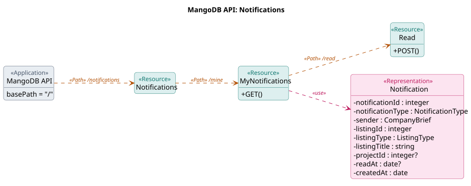
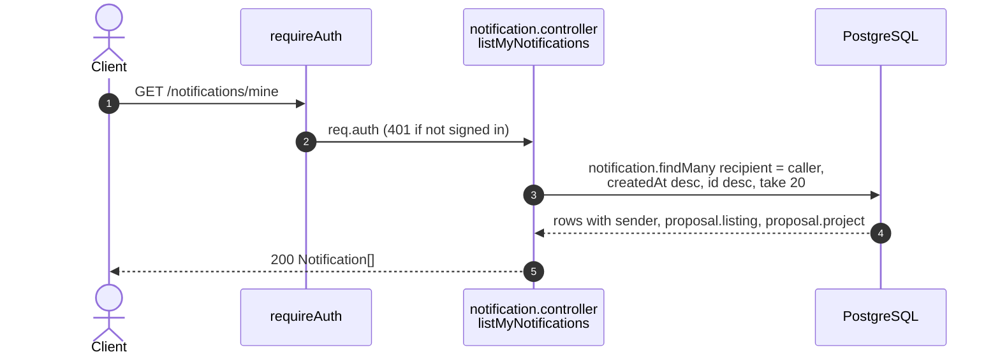
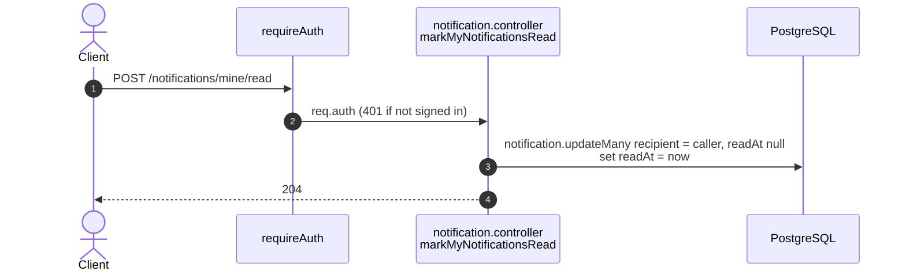

# Notification endpoints (`/notifications`)

Source: `apps/api/src/routes/notification.routes.ts`,
`apps/api/src/controllers/notification.controller.ts`,
`apps/api/src/lib/notification.ts`.
Back to the [index](README.md).

The navbar bell (T4.1.5, ADR 0017). A popup list, not a page, so the list is
the newest 20 and is not paged.

| Method | Path                       | Guards      | Success            |
| ------ | -------------------------- | ----------- | ------------------ |
| GET    | `/notifications/mine`      | requireAuth | 200 Notification[] |
| POST   | `/notifications/mine/read` | requireAuth | 204                |

## Who gets which notice

The action saves the notice in its own transaction, so a refused action
(403, 409) saves none. The sender is always the company that acted; the
recipient is the other side.

| `notificationType`   | Saved by                                                                         | Recipient       |
| -------------------- | -------------------------------------------------------------------------------- | --------------- |
| `PROPOSAL_RECEIVED`  | `POST /jobs/:jobId/proposals`, `POST /services/:serviceId/proposals`             | listing owner   |
| `PROPOSAL_ACCEPTED`  | `POST /proposals/:proposalId/accept`                                             | proposal sender |
| `PROPOSAL_REJECTED`  | `POST /proposals/:proposalId/reject`, accept on a job, `POST /jobs/:jobId/close` | proposal sender |
| `QUOTATION_SENT`     | `POST /projects/:projectId/quotations`                                           | Receiver        |
| `QUOTATION_ACCEPTED` | `POST /quotations/:quotationId/accept`                                           | Provider        |
| `QUOTATION_REJECTED` | `POST /quotations/:quotationId/reject`                                           | Provider        |
| `DEPOSIT_REPORTED`   | `POST /projects/:projectId/report-deposit`                                       | Provider        |
| `DEPOSIT_CONFIRMED`  | `POST /projects/:projectId/confirm-deposit`                                      | Receiver        |
| `PROJECT_CANCELLED`  | `POST /projects/:projectId/cancel`                                               | the other party |
| `WORK_SUBMITTED`     | `POST /projects/:projectId/submit-work`                                          | Receiver        |
| `WORK_REJECTED`      | `POST /projects/:projectId/reject-work`                                          | Provider        |
| `WORK_ACCEPTED`      | `POST /projects/:projectId/accept-work`                                          | Provider        |

A progress note and a deleted quotation save no notice.

## UML API Diagram

Source: [uml/notifications.puml](uml/notifications.puml). REST profile notation, see the [index](README.md#uml-api-diagram). Status codes, parameters and bodies are in the OpenAPI docs at `/api-docs`.

The sections below add one sequence diagram per endpoint: the steps inside the server.

## GET /notifications/mine

The caller's newest 20 notices, read or not, newest first. `projectId` is
null until the proposal is accepted.

## POST /notifications/mine/read

Opening the bell clears its badge. A notice already read keeps the time it
was first read.

