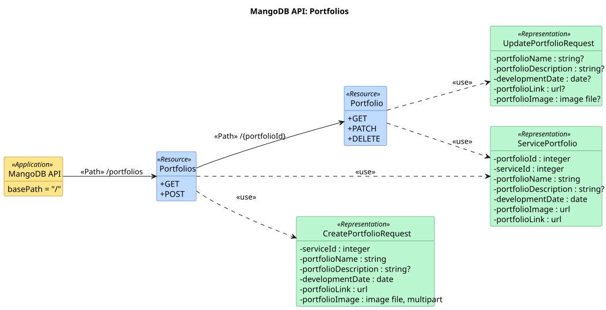
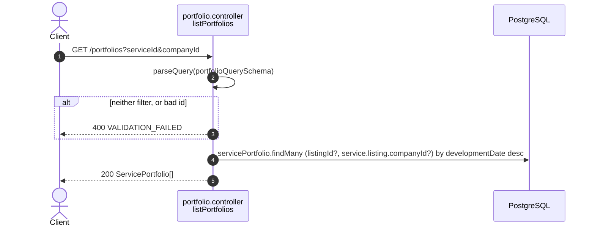
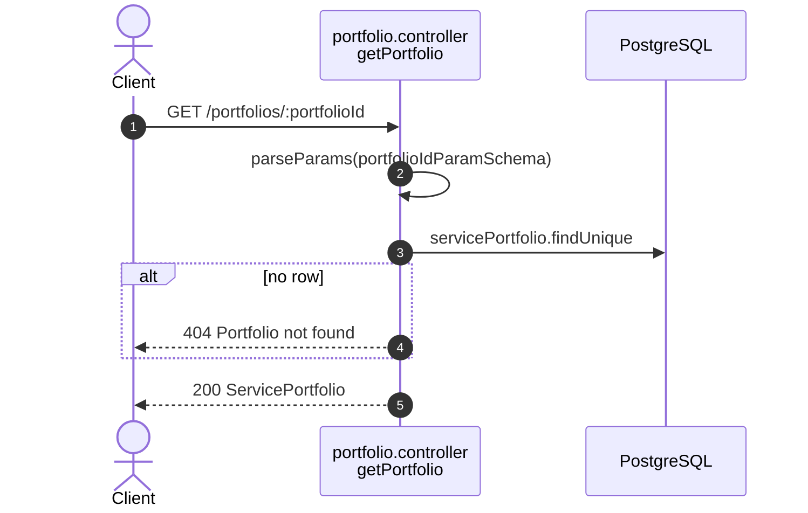
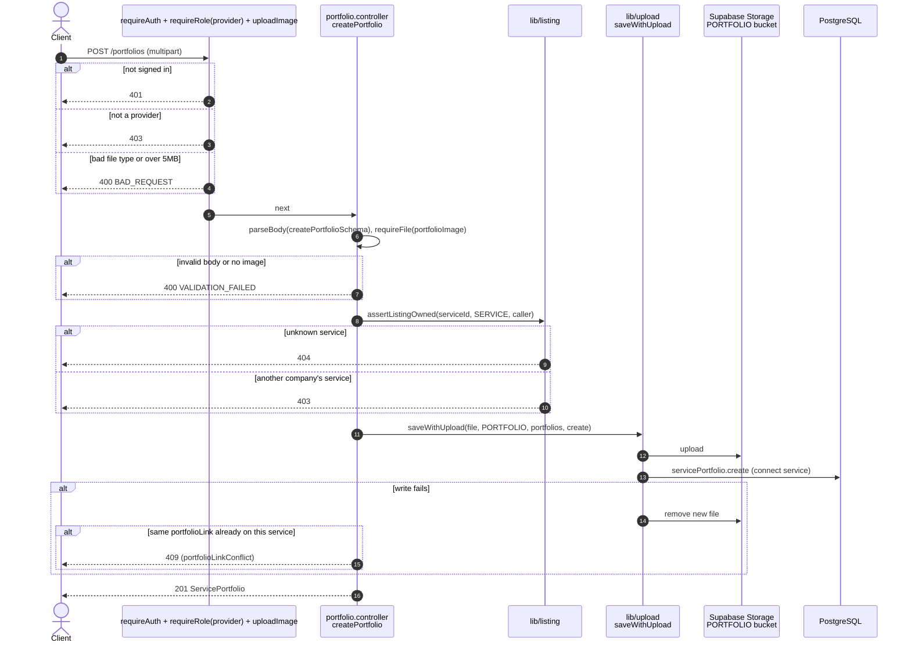
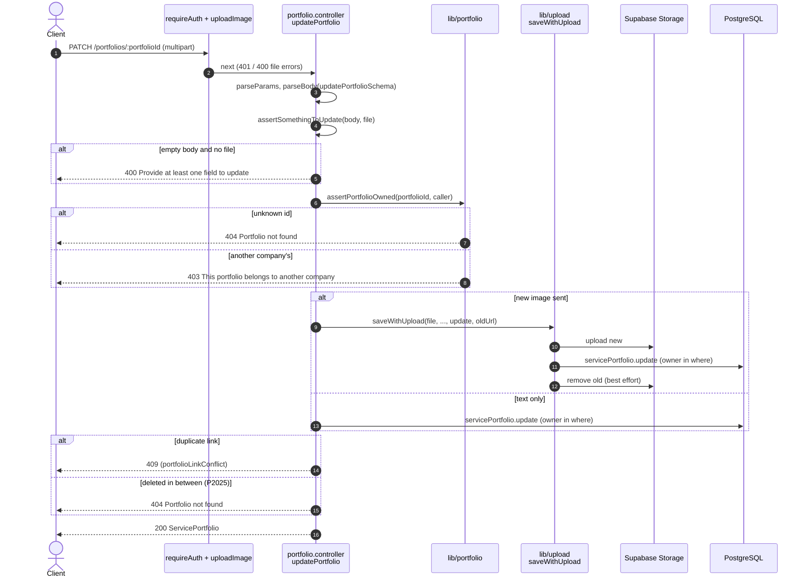
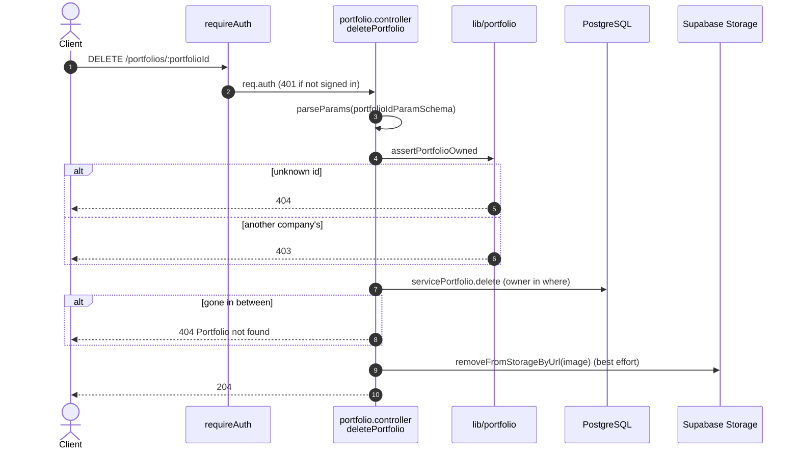

# Portfolio endpoints (`/portfolios`)

Source: `apps/api/src/routes/portfolio.routes.ts`,
`apps/api/src/controllers/portfolio.controller.ts`.
Back to the [index](README.md).

A portfolio item belongs to one service. The two GETs are public: no token.

| Method | Path                       | Guards                                       | Success                |
| ------ | -------------------------- | -------------------------------------------- | ---------------------- |
| GET    | `/portfolios`              | public                                       | 200 ServicePortfolio[] |
| GET    | `/portfolios/:portfolioId` | public                                       | 200 ServicePortfolio   |
| POST   | `/portfolios`              | provider, `uploadImage('portfolioImage')`    | 201 ServicePortfolio   |
| PATCH  | `/portfolios/:portfolioId` | auth, owner, `uploadImage('portfolioImage')` | 200 ServicePortfolio   |
| DELETE | `/portfolios/:portfolioId` | auth, owner                                  | 204                    |

## UML API Diagram

Source: [uml/portfolios.puml](uml/portfolios.puml). REST profile notation, see the [index](README.md#uml-api-diagram). Status codes, parameters and bodies are in the OpenAPI docs at `/api-docs`.

The sections below add one sequence diagram per endpoint: the steps inside the server.

## GET /portfolios

Public. The portfolios of one service, one company, or both. With neither
filter the schema answers 400.

## GET /portfolios/:portfolioId

Public. One portfolio item.

## POST /portfolios

Multipart: text fields plus one required image. The service must be the
caller's. The image is uploaded only after that check.

## PATCH /portfolios/:portfolioId

Owner only. Any of name, description, date, link, and a new image.

## DELETE /portfolios/:portfolioId

Owner only. Hard delete, then remove the image file.

