# Project endpoints (`/projects`)

Source: `apps/api/src/routes/project.routes.ts`,
`apps/api/src/controllers/project.controller.ts`.
Back to the [index](README.md).

A project is opened by `POST /proposals/:proposalId/accept` (see
[proposals.md](proposals.md)). Every route here needs only `requireAuth`.
There is no `requireRole`: a BOTH company can be either side, so the controller
works out the caller's side per project with `assertProjectParty`.

- Not a party to the project: **404**, as if it did not exist.
- A party, but the wrong side for this action: **403**.
- The right side, but the wrong status: **409**.

| Method | Path                                   | Who may act  | Success                     |
| ------ | -------------------------------------- | ------------ | --------------------------- |
| GET    | `/projects/mine`                       | any company  | 200 `{ items, pagination }` |
| GET    | `/projects/:projectId`                 | both parties | 200 ProjectDetail           |
| GET    | `/projects/:projectId/updates`         | both parties | 200 ProjectUpdate[]         |
| POST   | `/projects/:projectId/updates`         | Provider     | 201 ProjectUpdate           |
| POST   | `/projects/:projectId/report-deposit`  | Receiver     | 200 Project                 |
| POST   | `/projects/:projectId/confirm-deposit` | Provider     | 200 Project                 |
| POST   | `/projects/:projectId/submit-work`     | Provider     | 200 Project                 |
| POST   | `/projects/:projectId/reject-work`     | Receiver     | 200 Project                 |
| POST   | `/projects/:projectId/accept-work`     | Receiver     | 200 Project                 |
| POST   | `/projects/:projectId/review`          | Receiver     | 201 Review                  |
| GET    | `/projects/:projectId/review`          | both parties | 200 Review                  |

## UML API Diagram

REST profile notation (see the [index](README.md#uml-api-diagram-notation)). Each operation lists its status codes. Follow an arrow from `«Application»` to a `«Resource»` to read one HTTP call.

```mermaid
classDiagram
    direction LR
    class API["MangoDB API"] {
        <<Application>>
        basePath = "/"
    }
    class Projects["Projects"] {
        <<Resource>>
    }
    class MyProjects["MyProjects"] {
        <<Resource>>
        +GET(page, pageSize : QueryParam) 200 | 400 | 401
    }
    class ProjectR["Project"] {
        <<Resource>>
        +GET() 200 | 400 | 401 | 404
    }
    class Updates["Updates"] {
        <<Resource>>
        +GET() 200 | 400 | 401 | 404
        +POST(CreateProjectUpdateRequest) 201 | 400 | 401 | 403 | 404 | 409
    }
    class ReportDeposit["ReportDeposit"] {
        <<Resource>>
        +POST() 200 | 400 | 401 | 403 | 404 | 409
    }
    class ConfirmDeposit["ConfirmDeposit"] {
        <<Resource>>
        +POST() 200 | 400 | 401 | 403 | 404 | 409
    }
    class SubmitWork["SubmitWork"] {
        <<Resource>>
        +POST() 200 | 400 | 401 | 403 | 404 | 409
    }
    class RejectWork["RejectWork"] {
        <<Resource>>
        +POST(RejectWorkRequest) 200 | 400 | 401 | 403 | 404 | 409
    }
    class AcceptWork["AcceptWork"] {
        <<Resource>>
        +POST() 200 | 400 | 401 | 403 | 404 | 409
    }
    class ReviewR["Review"] {
        <<Resource>>
        +GET() 200 | 400 | 401 | 404
        +POST(CreateReviewRequest) 201 | 400 | 401 | 403 | 404 | 409
    }
    class ProjectSummaryRep["ProjectSummary"] {
        <<Representation>>
        -Project fields
        -listingTitle : string
        -myRole : provider, receiver
        -otherParty : CompanyBrief
    }
    class ProjectDetailRep["ProjectDetail"] {
        <<Representation>>
        -Project fields
        -listingId : number
        -listingType : JOB, SERVICE
        -listingTitle : string
        -provider : CompanyBrief
        -receiver : CompanyBrief
        -myRole : provider, receiver
    }
    class ProjectUpdateRep["ProjectUpdate"] {
        <<Representation>>
        -projectUpdateId : number
        -projectId : number
        -updateType : PROGRESS, WORK_REJECTED
        -updateText : string
        -createdAt : date
    }
    class CreateProjectUpdateRequestRep["CreateProjectUpdateRequest"] {
        <<Representation>>
        -updateText : string
    }
    class ProjectRep["Project"] {
        <<Representation>>
        -projectId : number
        -proposalId : number
        -totalBudget : number
        -startDate : date
        -projectStatus : ProjectStatus
        -depositReportedAt : date?
        -depositConfirmedAt : date?
        -completedAt : date?
    }
    class RejectWorkRequestRep["RejectWorkRequest"] {
        <<Representation>>
        -reason : string
    }
    class ReviewRep["Review"] {
        <<Representation>>
        -reviewId : number
        -projectId : number
        -workQualityScore : 1-5
        -serviceScore : 1-5
        -valueForMoneyScore : 1-5
        -deliveryTimeScore : 1-5
        -comment : string?
        -createdAt : date
    }
    class CreateReviewRequestRep["CreateReviewRequest"] {
        <<Representation>>
        -workQualityScore : 1-5
        -serviceScore : 1-5
        -valueForMoneyScore : 1-5
        -deliveryTimeScore : 1-5
        -comment : string?
    }
    API --> Projects : «Path» /projects
    Projects --> MyProjects : «Path» /mine
    MyProjects ..> ProjectSummaryRep : «use»
    Projects --> ProjectR : «Path» /{projectId}
    ProjectR ..> ProjectDetailRep : «use»
    ProjectR --> Updates : «Path» /updates
    Updates ..> ProjectUpdateRep : «use»
    Updates ..> CreateProjectUpdateRequestRep : «use»
    ProjectR --> ReportDeposit : «Path» /report-deposit
    ReportDeposit ..> ProjectRep : «use»
    ProjectR --> ConfirmDeposit : «Path» /confirm-deposit
    ConfirmDeposit ..> ProjectRep : «use»
    ProjectR --> SubmitWork : «Path» /submit-work
    SubmitWork ..> ProjectRep : «use»
    ProjectR --> RejectWork : «Path» /reject-work
    RejectWork ..> RejectWorkRequestRep : «use»
    RejectWork ..> ProjectRep : «use»
    ProjectR --> AcceptWork : «Path» /accept-work
    AcceptWork ..> ProjectRep : «use»
    ProjectR --> ReviewR : «Path» /review
    ReviewR ..> ReviewRep : «use»
    ReviewR ..> CreateReviewRequestRep : «use»
    style API fill:#fde68a,stroke:#b45309
    style Projects fill:#bfdbfe,stroke:#1d4ed8
    style MyProjects fill:#bfdbfe,stroke:#1d4ed8
    style ProjectR fill:#bfdbfe,stroke:#1d4ed8
    style Updates fill:#bfdbfe,stroke:#1d4ed8
    style ReportDeposit fill:#bfdbfe,stroke:#1d4ed8
    style ConfirmDeposit fill:#bfdbfe,stroke:#1d4ed8
    style SubmitWork fill:#bfdbfe,stroke:#1d4ed8
    style RejectWork fill:#bfdbfe,stroke:#1d4ed8
    style AcceptWork fill:#bfdbfe,stroke:#1d4ed8
    style ReviewR fill:#bfdbfe,stroke:#1d4ed8
    style ProjectSummaryRep fill:#bbf7d0,stroke:#15803d
    style ProjectDetailRep fill:#bbf7d0,stroke:#15803d
    style ProjectUpdateRep fill:#bbf7d0,stroke:#15803d
    style CreateProjectUpdateRequestRep fill:#bbf7d0,stroke:#15803d
    style ProjectRep fill:#bbf7d0,stroke:#15803d
    style RejectWorkRequestRep fill:#bbf7d0,stroke:#15803d
    style ReviewRep fill:#bbf7d0,stroke:#15803d
    style CreateReviewRequestRep fill:#bbf7d0,stroke:#15803d
```

The sections below add one sequence diagram per endpoint: the steps inside the server.

## State diagram: project status

ADR 0015. `moveProjectStatus` in `lib/project.ts` allows only these moves.

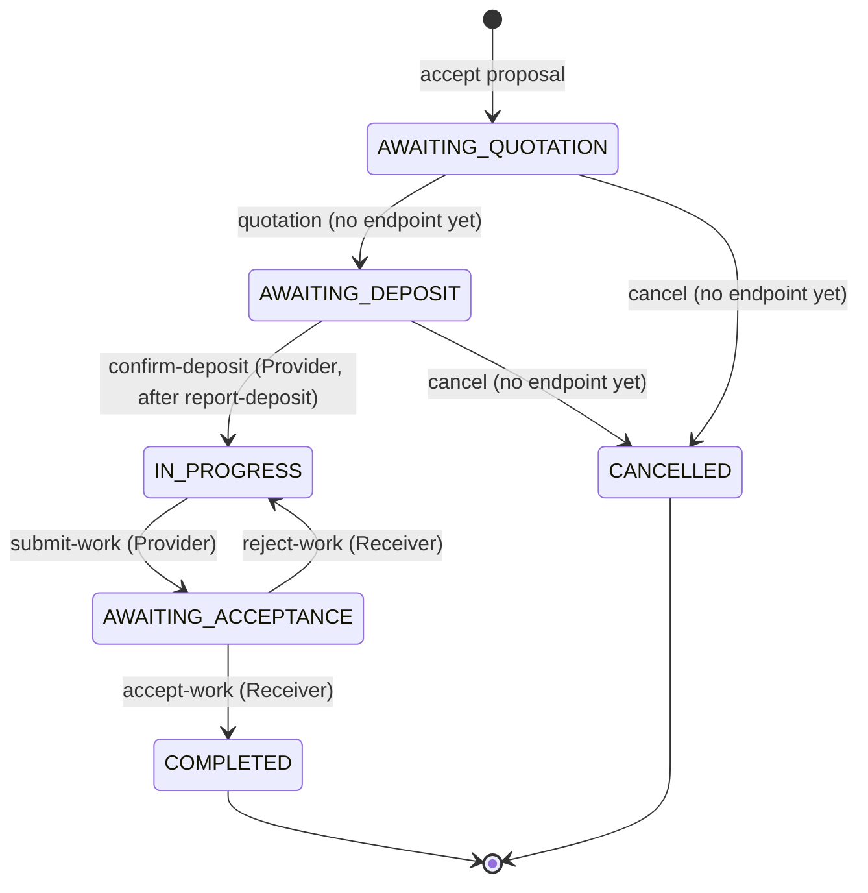

## Shared step: assertProjectParty

Every `/:projectId` route starts with this. The diagrams below draw it as one
call.

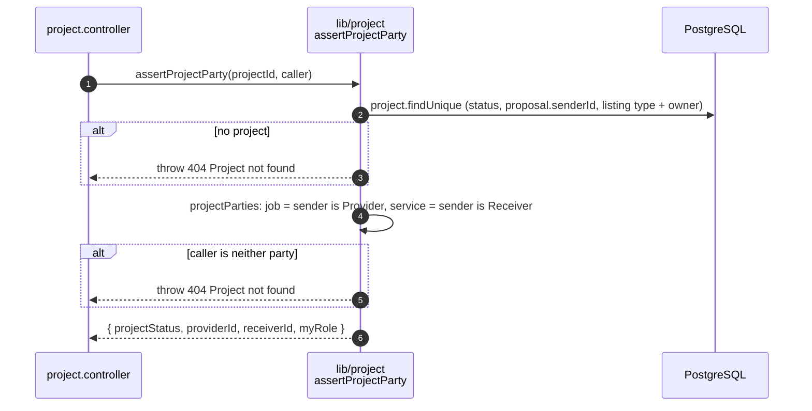

## GET /projects/mine

US4-9. The caller's projects on both sides, newest first. Paged.

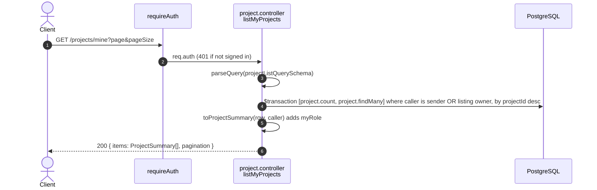

## GET /projects/:projectId

US4-9. One project, for its two parties.

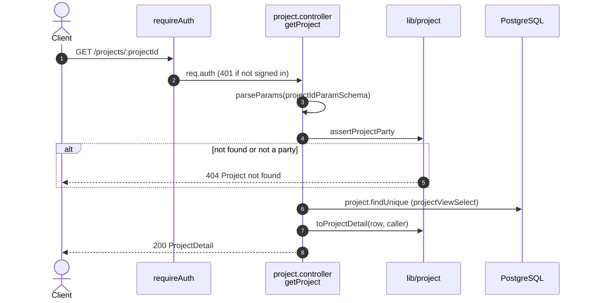

## GET /projects/:projectId/updates

US4-9. The progress timeline, oldest first. Not paged.

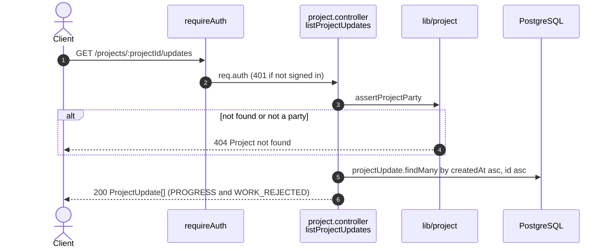

## POST /projects/:projectId/updates

US4-10. The Provider adds a progress note while IN_PROGRESS.

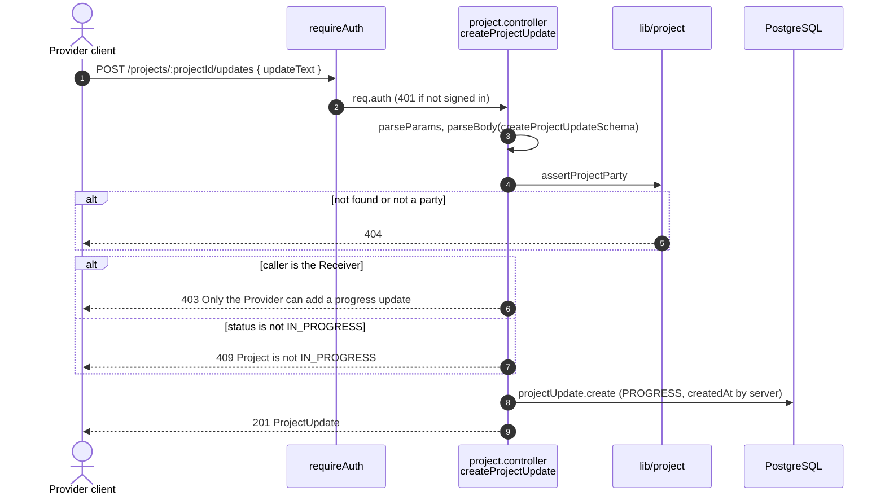

## POST /projects/:projectId/report-deposit

US4-6. The Receiver says the deposit is paid. Only the time is saved. The
status stays AWAITING_DEPOSIT.

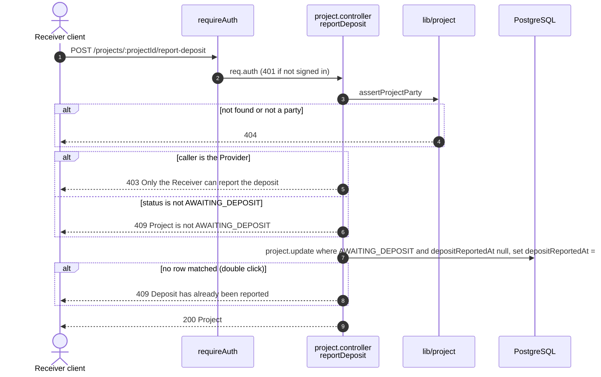

## POST /projects/:projectId/confirm-deposit

US4-7. The Provider confirms the deposit. AWAITING_DEPOSIT to IN_PROGRESS.

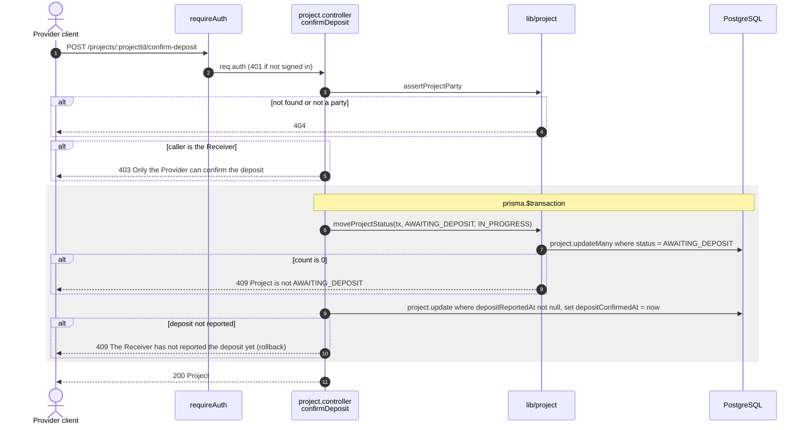

## POST /projects/:projectId/submit-work

US4-11. The Provider reports the work complete. IN_PROGRESS to
AWAITING_ACCEPTANCE.

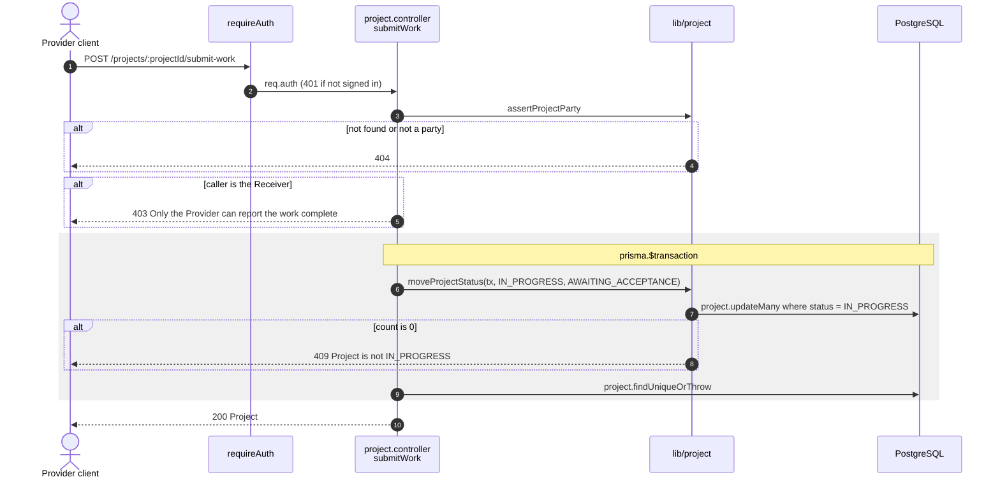

## POST /projects/:projectId/reject-work

US4-12. The Receiver rejects the work with a reason. AWAITING_ACCEPTANCE back
to IN_PROGRESS. The reason goes on the timeline.

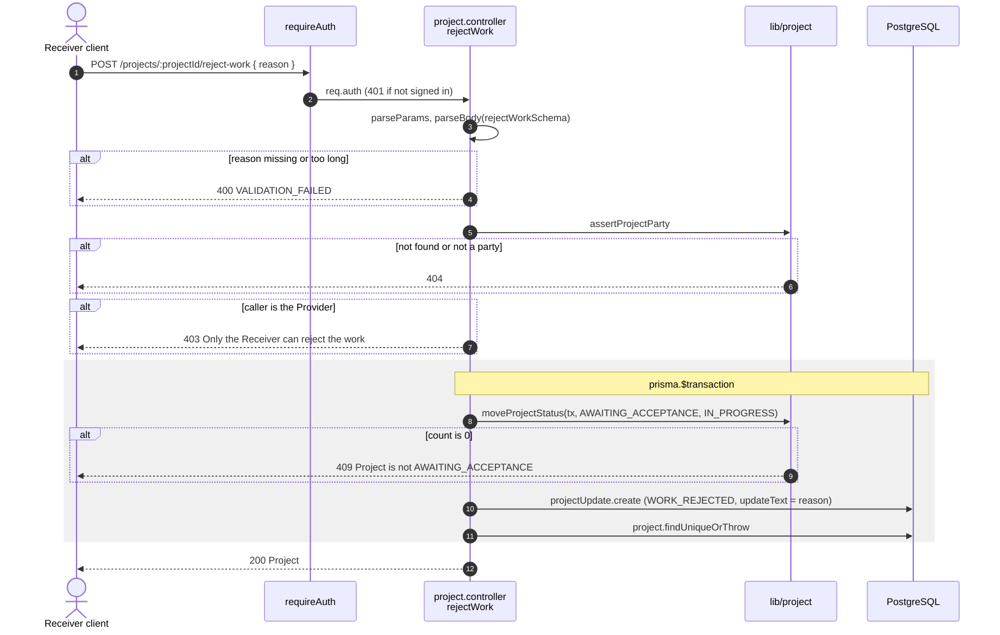

## POST /projects/:projectId/accept-work

US4-13. The Receiver accepts the work. AWAITING_ACCEPTANCE to COMPLETED.

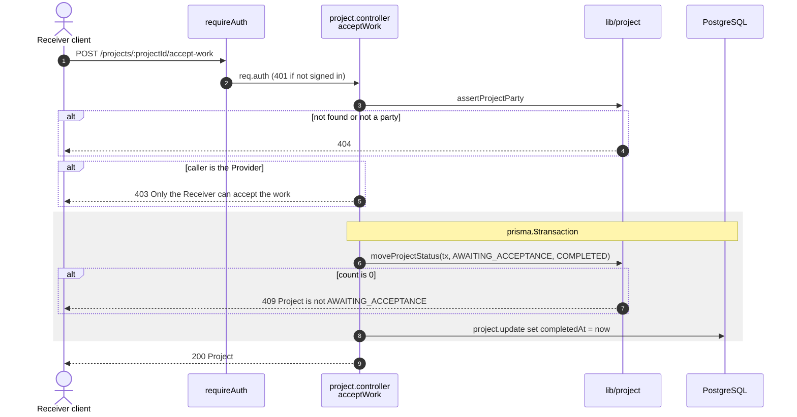

## POST /projects/:projectId/review

US5-1. The Receiver reviews a completed project once (ADR 0018).

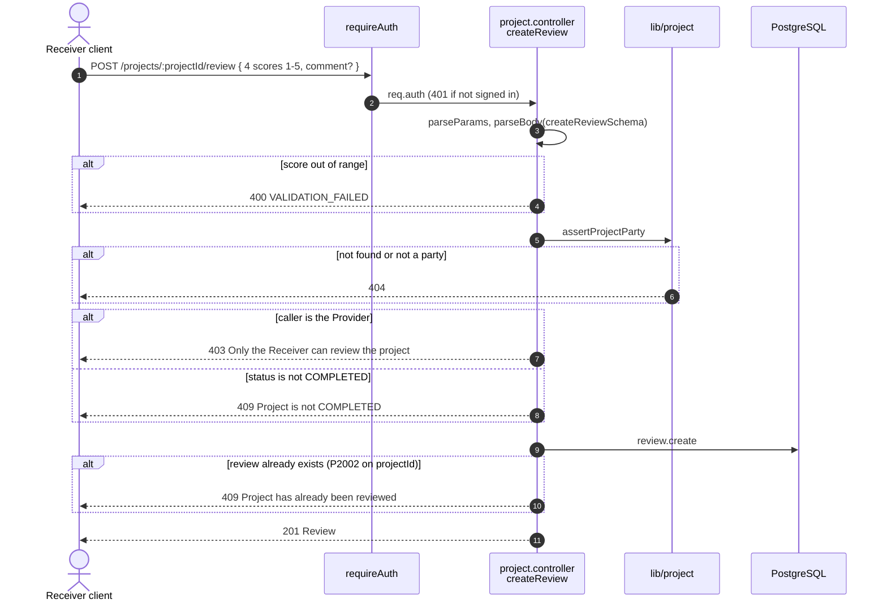

## GET /projects/:projectId/review

US5-3. The project's review, for both parties. 404 until there is one.

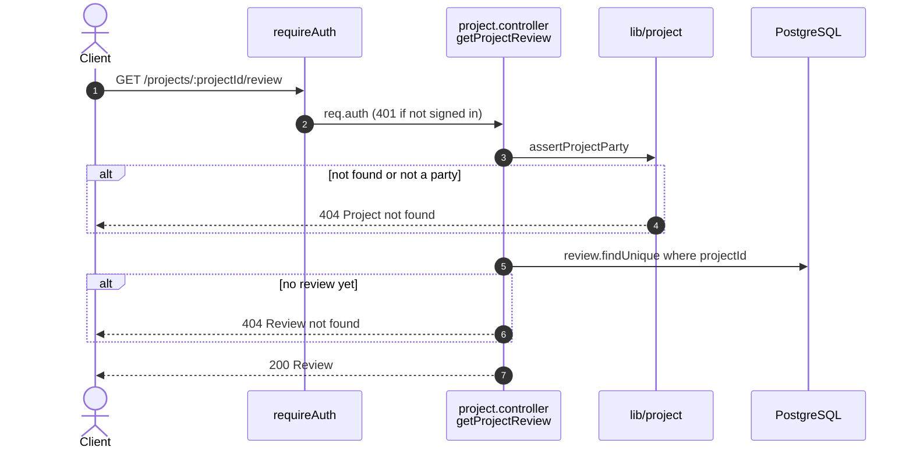
