# Project endpoints (`/projects`)

Source: `apps/api/src/routes/project.routes.ts`,
`apps/api/src/controllers/project.controller.ts`.
Back to the [index](README.md).

Quotations are decided on their own paths under `/quotations`, see
[quotations.md](quotations.md).

A project is opened by `POST /proposals/:proposalId/accept` (see
[proposals.md](proposals.md)). Every route here needs only `requireAuth`.
There is no `requireRole`: a BOTH company can be either side, so the controller
works out the caller's side per project with `assertProjectParty`.

- Not a party to the project: **404**, as if it did not exist.
- A party, but the wrong side for this action: **403**.
- The right side, but the wrong status: **409**.

| Method | Path                                   | Who may act  | Success                     |
| ------ | -------------------------------------- | ------------ | --------------------------- |
| GET    | `/projects/mine`                       | any company  | 200 `{ items, pagination }` |
| GET    | `/projects/:projectId`                 | both parties | 200 ProjectDetail           |
| GET    | `/projects/:projectId/updates`         | both parties | 200 ProjectUpdate[]         |
| POST   | `/projects/:projectId/updates`         | Provider     | 201 ProjectUpdate           |
| GET    | `/projects/:projectId/quotations`      | both parties | 200 Quotation[]             |
| POST   | `/projects/:projectId/quotations`      | Provider     | 201 Quotation               |
| POST   | `/projects/:projectId/cancel`          | both parties | 200 Project                 |
| POST   | `/projects/:projectId/report-deposit`  | Receiver     | 200 Project                 |
| POST   | `/projects/:projectId/confirm-deposit` | Provider     | 200 Project                 |
| POST   | `/projects/:projectId/submit-work`     | Provider     | 200 Project                 |
| POST   | `/projects/:projectId/reject-work`     | Receiver     | 200 Project                 |
| POST   | `/projects/:projectId/accept-work`     | Receiver     | 200 Project                 |
| POST   | `/projects/:projectId/review`          | Receiver     | 201 Review                  |
| GET    | `/projects/:projectId/review`          | both parties | 200 Review                  |

## UML API Diagram

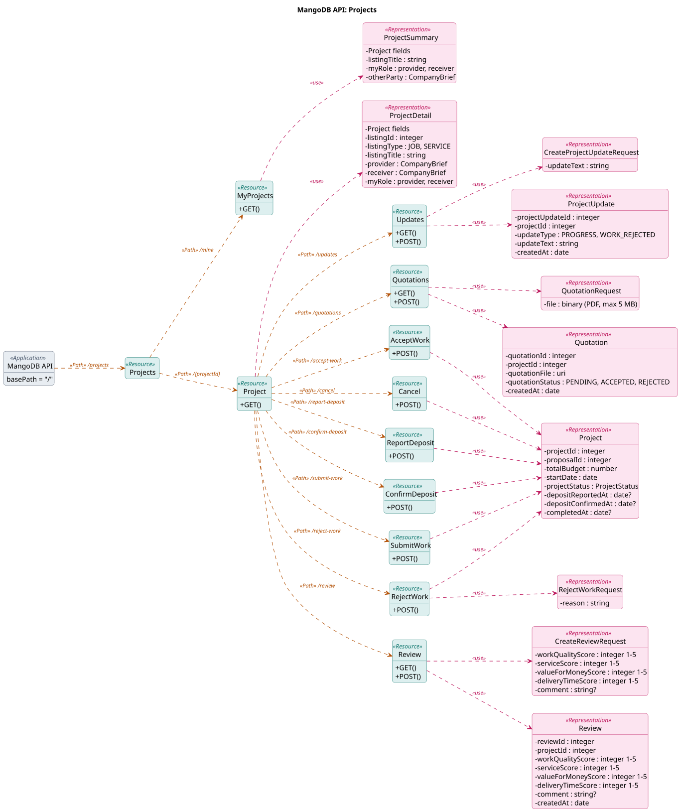

Source: [uml/projects.puml](uml/projects.puml). REST profile notation, see the [index](README.md#uml-api-diagram). Status codes, parameters and bodies are in the OpenAPI docs at `/api-docs`.

The sections below add one sequence diagram per endpoint: the steps inside the server.

## State diagram: project status

ADR 0015. `moveProjectStatus` in `lib/project.ts` allows only these moves.

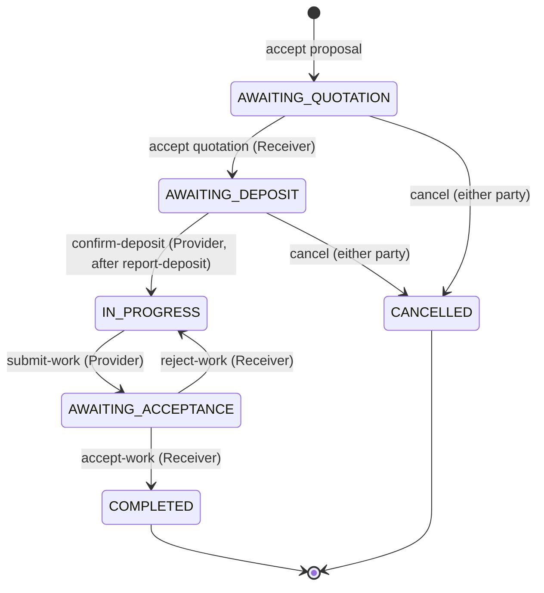

## Shared step: assertProjectParty

Every `/:projectId` route starts with this. The diagrams below draw it as one
call.

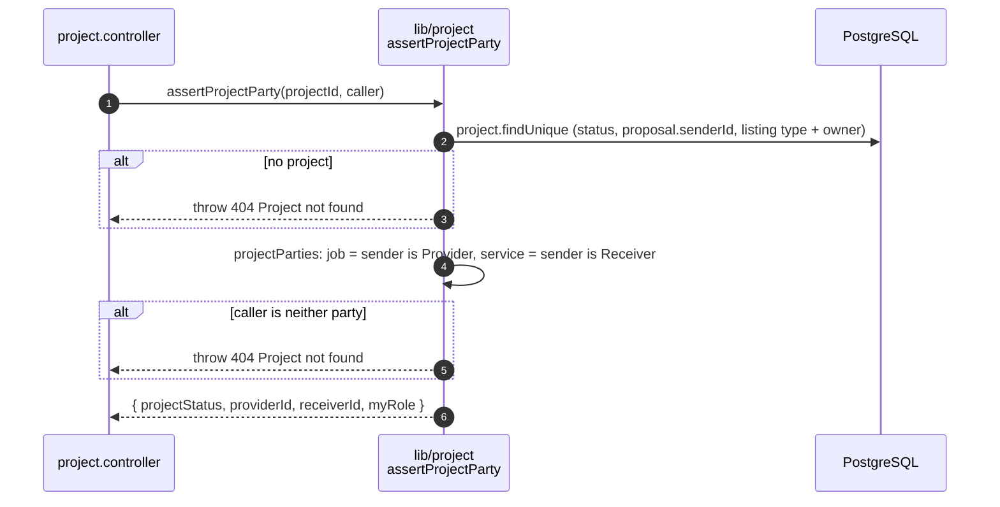

## GET /projects/mine

US4-9. The caller's projects on both sides, newest first. Paged.

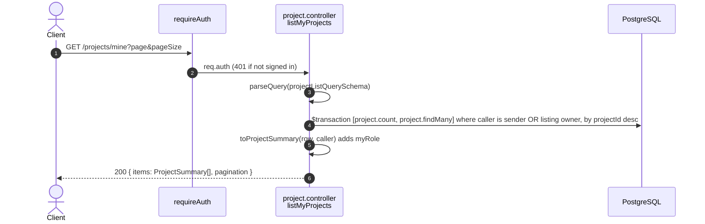

## GET /projects/:projectId

US4-9. One project, for its two parties.

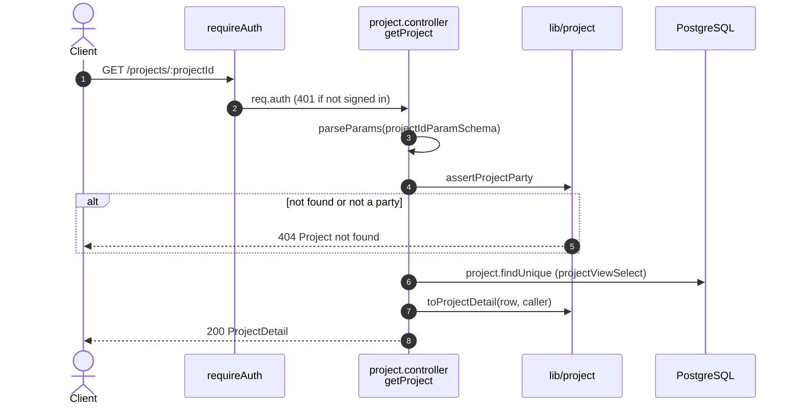

## GET /projects/:projectId/updates

US4-9. The project's whole timeline, oldest first. Not paged.

Each action saves one event inside the action's own transaction, so a
refused action (403, 409) saves none (#212). Only `PROGRESS` and `WORK_REJECTED` have
`updateText`; on the rest it is `null`.

| `updateType`         | Saved by                                    |
| -------------------- | ------------------------------------------- |
| `PROPOSAL_ACCEPTED`  | `POST /proposals/:proposalId/accept`        |
| `QUOTATION_SENT`     | `POST /projects/:projectId/quotations`      |
| `QUOTATION_DELETED`  | `DELETE /quotations/:quotationId`           |
| `QUOTATION_REJECTED` | `POST /quotations/:quotationId/reject`      |
| `QUOTATION_ACCEPTED` | `POST /quotations/:quotationId/accept`      |
| `DEPOSIT_REPORTED`   | `POST /projects/:projectId/report-deposit`  |
| `DEPOSIT_CONFIRMED`  | `POST /projects/:projectId/confirm-deposit` |
| `PROGRESS`           | `POST /projects/:projectId/updates`         |
| `WORK_SUBMITTED`     | `POST /projects/:projectId/submit-work`     |
| `WORK_REJECTED`      | `POST /projects/:projectId/reject-work`     |
| `WORK_ACCEPTED`      | `POST /projects/:projectId/accept-work`     |
| `PROJECT_CANCELLED`  | `POST /projects/:projectId/cancel`          |

A deleted quotation keeps its `QUOTATION_SENT` event: the timeline is
append-only.

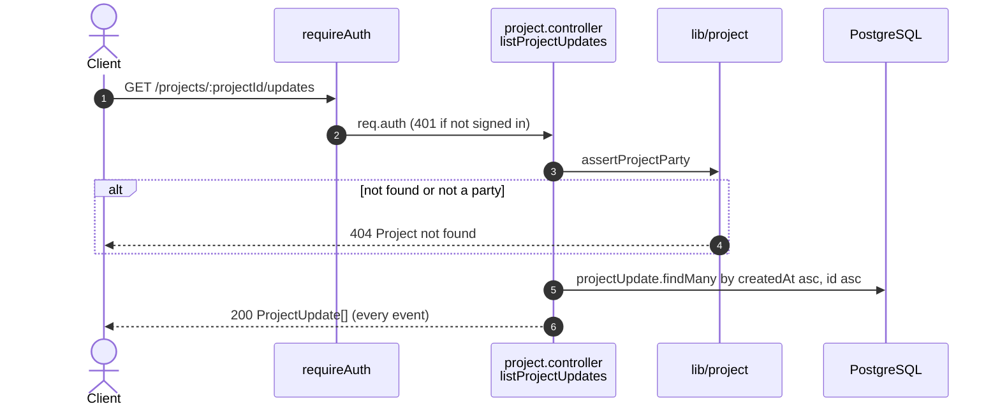

## POST /projects/:projectId/updates

US4-10. The Provider adds a progress note while IN_PROGRESS.

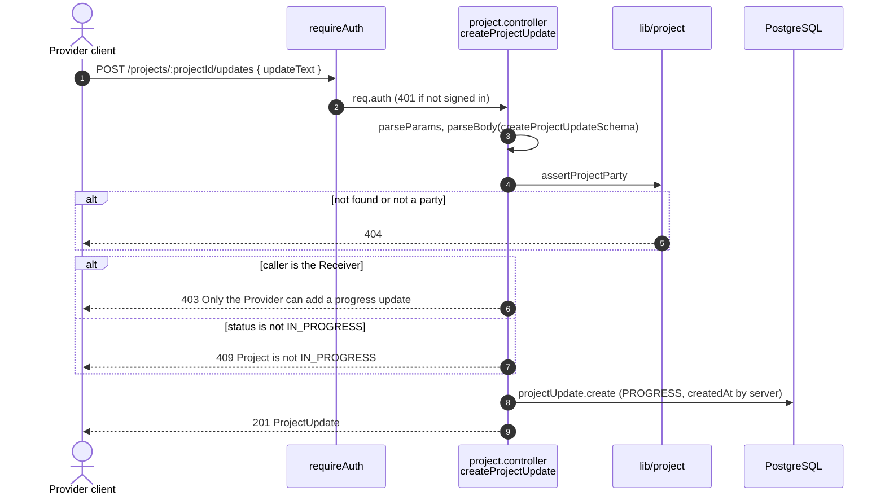

## GET /projects/:projectId/quotations

US4-3. The project's quotations, newest first, for both parties. A plain
array, not paged.

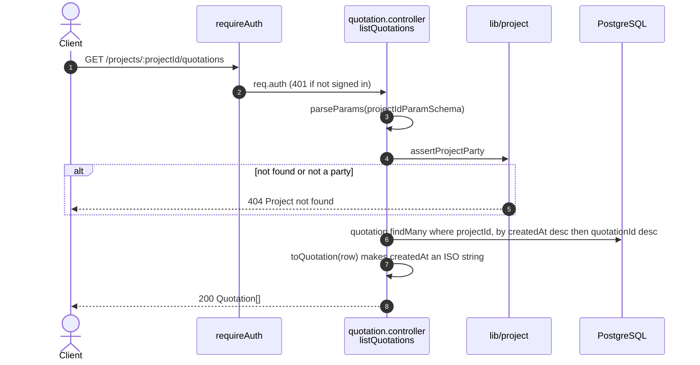

## POST /projects/:projectId/quotations

US4-1. The Provider uploads a quotation PDF (multipart, field `file`, up to
5 MB). The project stays AWAITING_QUOTATION until the Receiver accepts one.

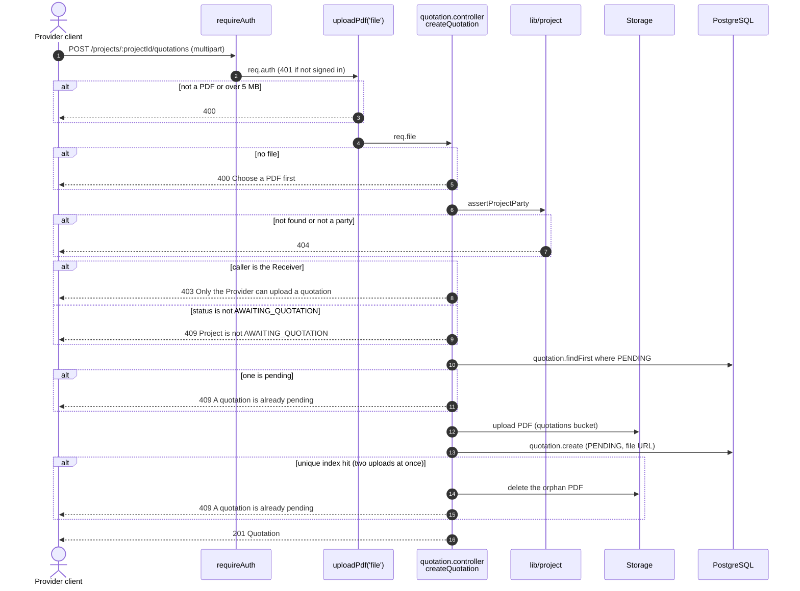

## POST /projects/:projectId/cancel

US4-8. Either party cancels before work starts: AWAITING_QUOTATION or
AWAITING_DEPOSIT to CANCELLED.

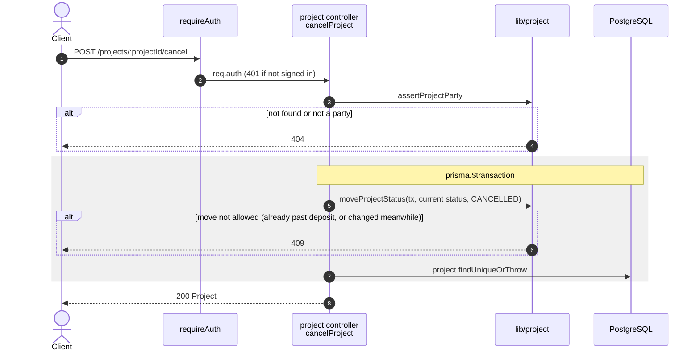

## POST /projects/:projectId/report-deposit

US4-6. The Receiver says the deposit is paid. Only the time is saved. The
status stays AWAITING_DEPOSIT.

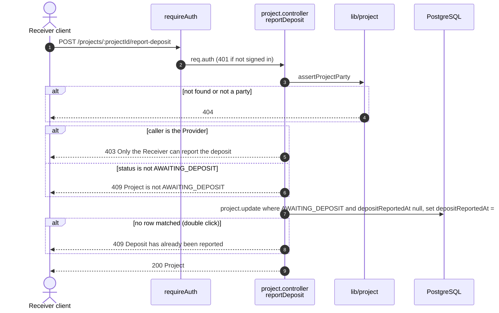

## POST /projects/:projectId/confirm-deposit

US4-7. The Provider confirms the deposit. AWAITING_DEPOSIT to IN_PROGRESS.

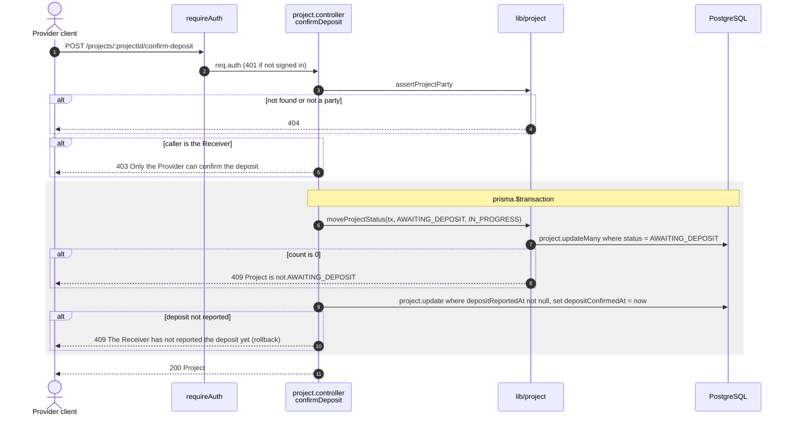

## POST /projects/:projectId/submit-work

US4-11. The Provider reports the work complete. IN_PROGRESS to
AWAITING_ACCEPTANCE.

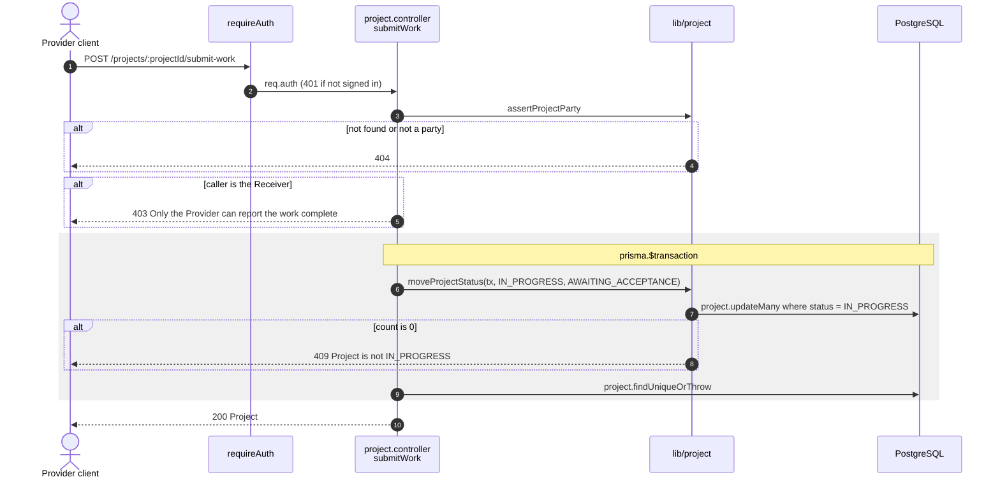

## POST /projects/:projectId/reject-work

US4-12. The Receiver rejects the work with a reason. AWAITING_ACCEPTANCE back
to IN_PROGRESS. The reason goes on the timeline.

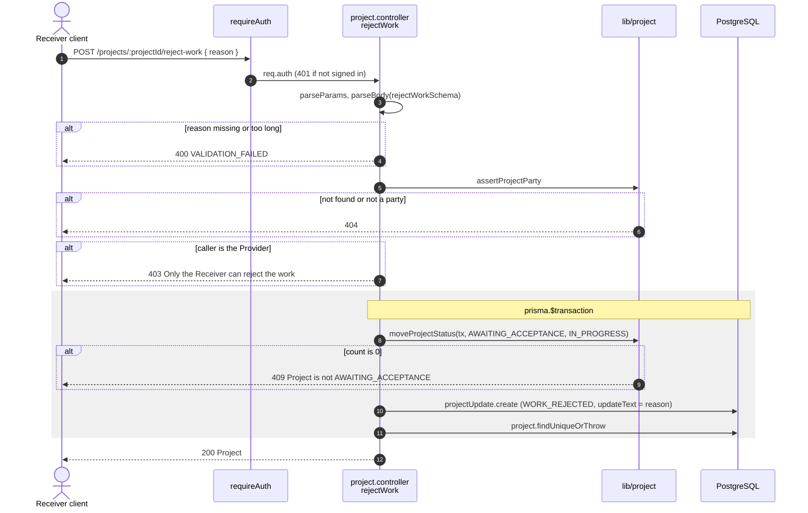

## POST /projects/:projectId/accept-work

US4-13. The Receiver accepts the work. AWAITING_ACCEPTANCE to COMPLETED.

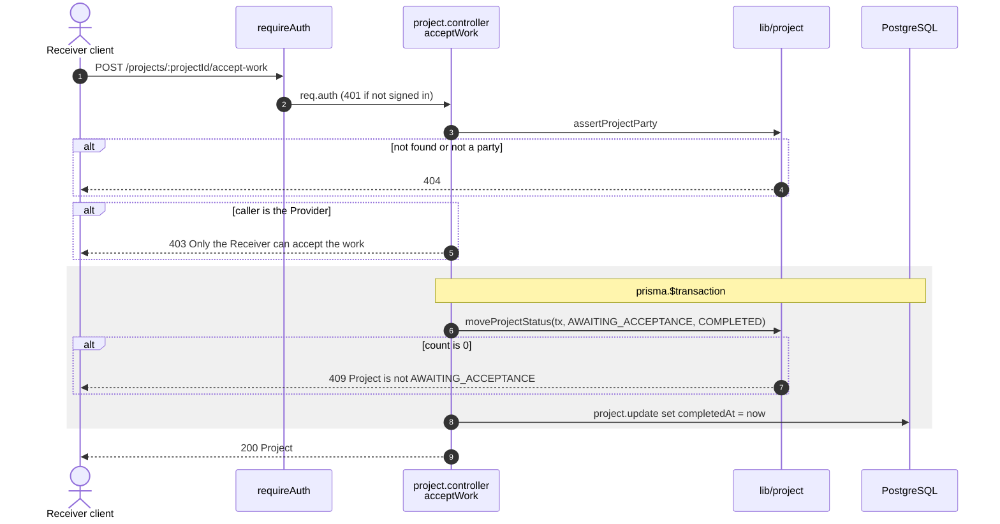

## POST /projects/:projectId/review

US5-1. The Receiver reviews a completed project once (ADR 0018).

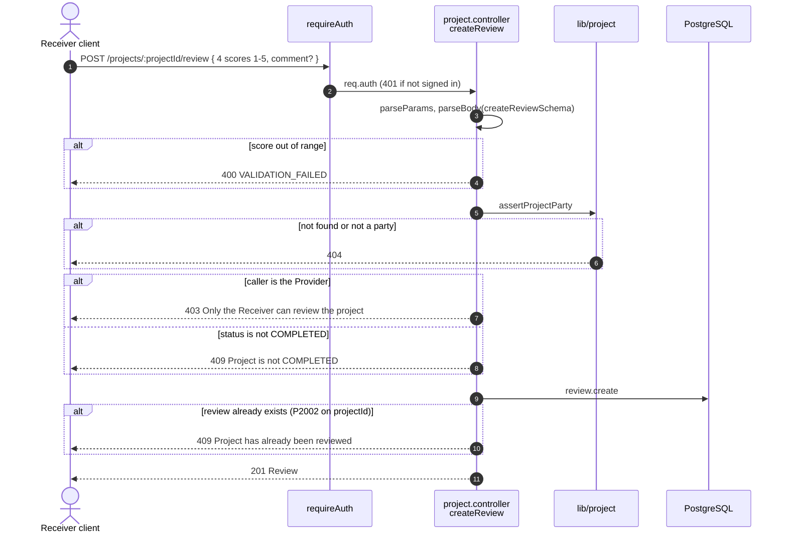

## GET /projects/:projectId/review

US5-3. The project's review, for both parties. 404 until there is one.

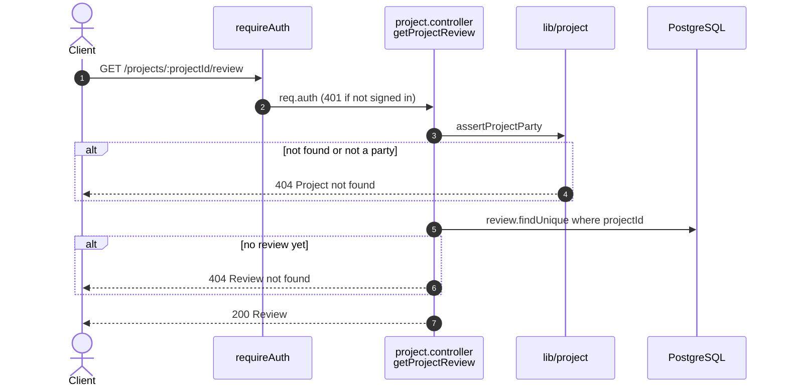
