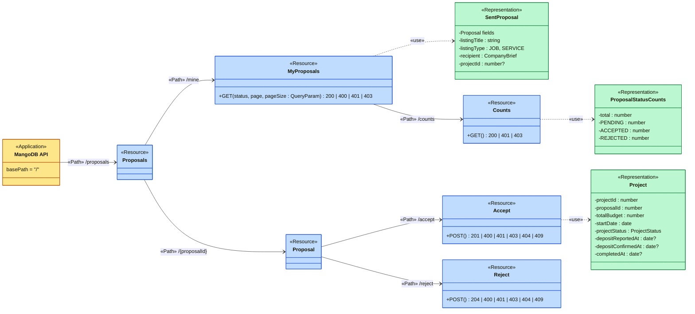
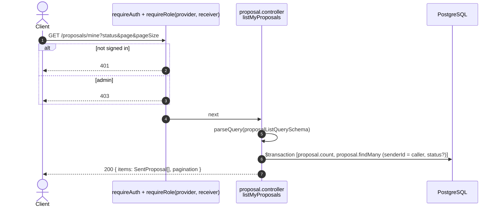
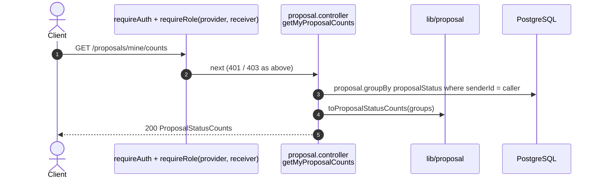
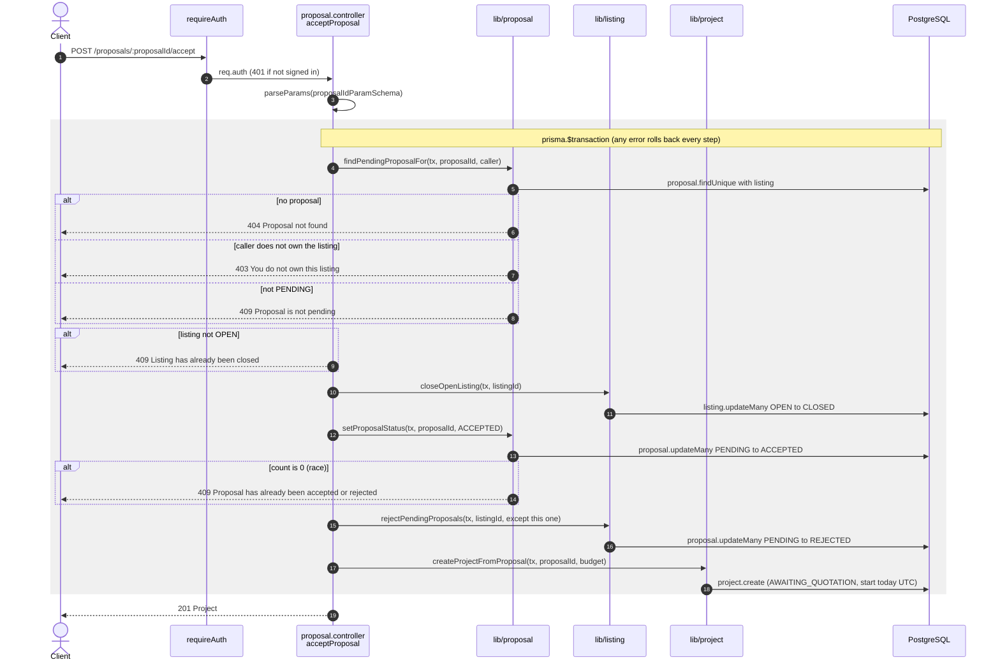
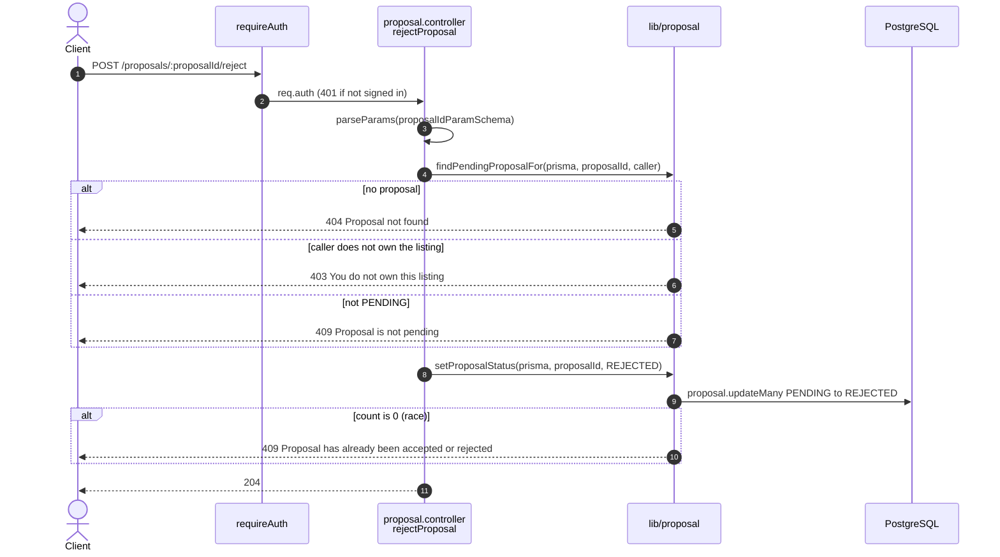

# Proposal endpoints (`/proposals`)

Source: `apps/api/src/routes/proposal.routes.ts`,
`apps/api/src/controllers/proposal.controller.ts`.
Back to the [index](README.md).

Sending a proposal is `POST /jobs/:jobId/proposals`, in [jobs.md](jobs.md).
Every route here needs `requireAuth`.

| Method | Path                            | Guards              | Success                     |
| ------ | ------------------------------- | ------------------- | --------------------------- |
| GET    | `/proposals/mine`               | provider, receiver  | 200 `{ items, pagination }` |
| GET    | `/proposals/mine/counts`        | provider, receiver  | 200 counts by status        |
| POST   | `/proposals/:proposalId/accept` | auth, listing owner | 201 Project                 |
| POST   | `/proposals/:proposalId/reject` | auth, listing owner | 204                         |

## UML API Diagram

REST profile notation (see the [index](README.md#uml-api-diagram-notation)). Each operation lists its status codes. Follow an arrow from `«Application»` to a `«Resource»` to read one HTTP call.

The sections below add one sequence diagram per endpoint: the steps inside the server.

## GET /proposals/mine

US2-9. Proposals and hire requests the caller sent, newest first. Paged.

## GET /proposals/mine/counts

US2-9. Numbers for the status chips. Ignores `?status`.

## POST /proposals/:proposalId/accept

US2-11. All or nothing: close the listing, accept this proposal, reject the
others, and open a project.

## POST /proposals/:proposalId/reject

Reject one PENDING proposal. No other row changes.

