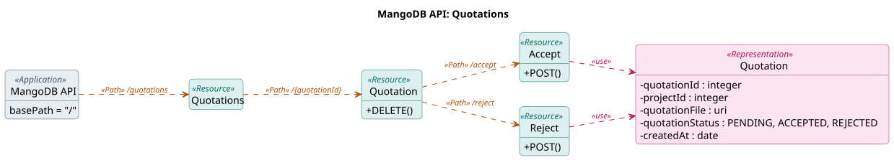
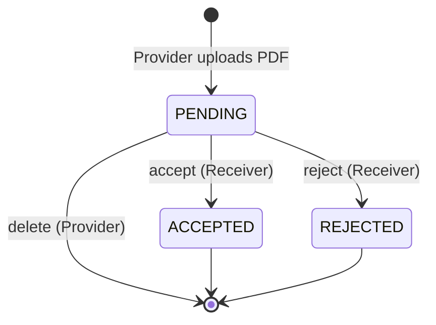
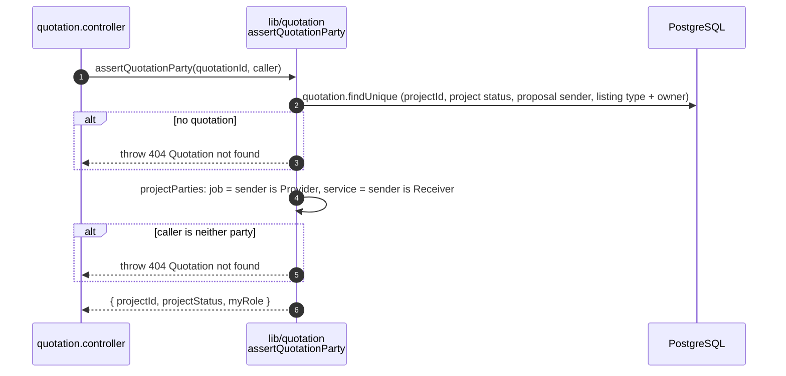
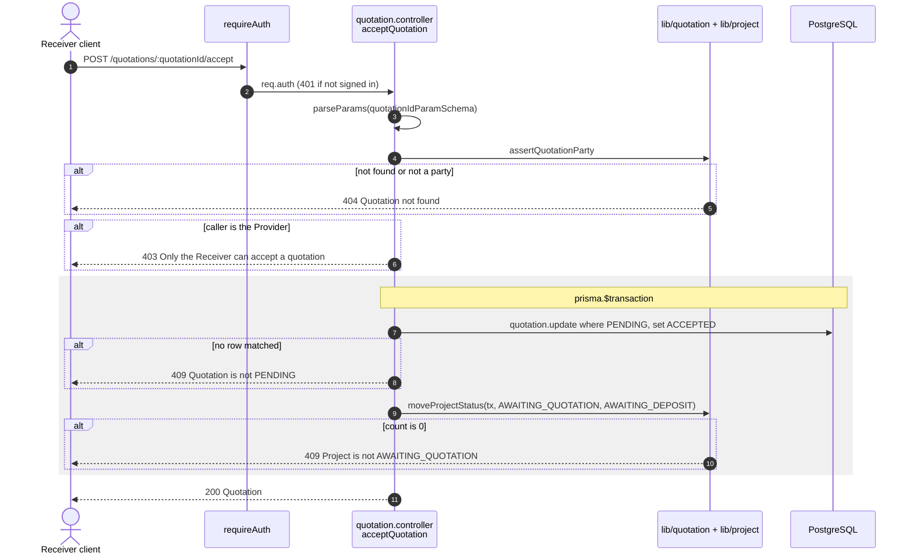
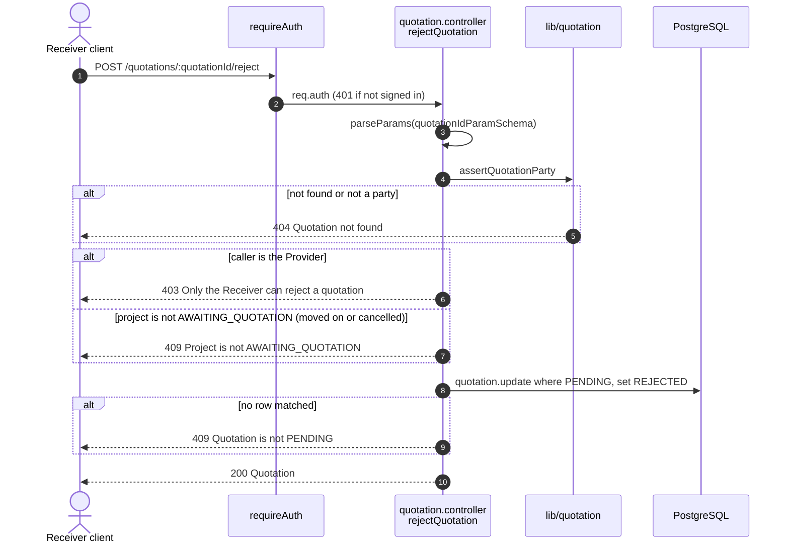
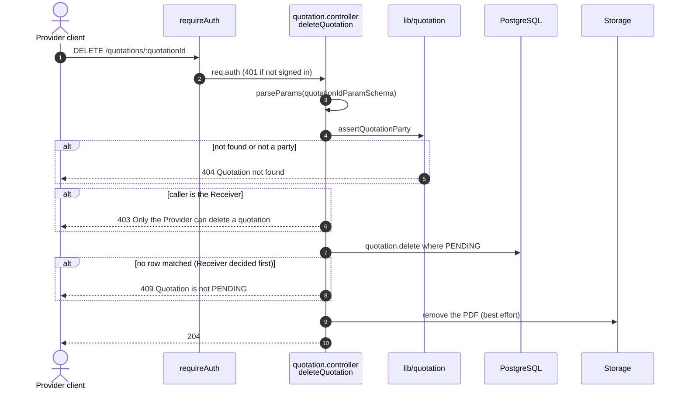

# Quotation endpoints (`/quotations`)

Source: `apps/api/src/routes/quotation.routes.ts`,
`apps/api/src/controllers/quotation.controller.ts`.
Back to the [index](README.md).

A quotation is one PDF on a project (ADR 0017). Uploading one and listing them
happen under the project: `POST` and `GET /projects/:projectId/quotations`, see
[projects.md](projects.md). The three endpoints here act on one quotation by
its own id, so the project does not appear in the path.

Every route needs only `requireAuth`. There is no `requireRole`: a BOTH company
can be either side, so the controller works out the caller's side per project
with `assertQuotationParty`.

- Not a party to the quotation's project: **404**, as if it did not exist.
- A party, but the wrong side for this action: **403**.
- The right side, but the quotation is not PENDING (or the project is in the
  wrong status): **409**.

| Method | Path                              | Who may act | Success       |
| ------ | --------------------------------- | ----------- | ------------- |
| POST   | `/quotations/:quotationId/accept` | Receiver    | 200 Quotation |
| POST   | `/quotations/:quotationId/reject` | Receiver    | 200 Quotation |
| DELETE | `/quotations/:quotationId`        | Provider    | 204 (no body) |

## UML API Diagram

Source: [uml/quotations.puml](uml/quotations.puml). REST profile notation, see the [index](README.md#uml-api-diagram). Status codes, parameters and bodies are in the OpenAPI docs at `/api-docs`.

The sections below add one sequence diagram per endpoint: the steps inside the server.

## State diagram: quotation status

Only one quotation per project can be PENDING at a time. After a reject, the
Provider can upload a new one.

## Shared step: assertQuotationParty

Every `/:quotationId` route starts with this.

## POST /quotations/:quotationId/accept

US4-4. The Receiver accepts a pending quotation. The quotation becomes
ACCEPTED and the project moves from AWAITING_QUOTATION to AWAITING_DEPOSIT,
in one transaction.

## POST /quotations/:quotationId/reject

US4-5. The Receiver rejects a pending quotation. The project stays
AWAITING_QUOTATION so the Provider can send a new one.

## DELETE /quotations/:quotationId

US4-2. The Provider deletes a pending quotation, so a wrong PDF can be
replaced before the Receiver answers.

