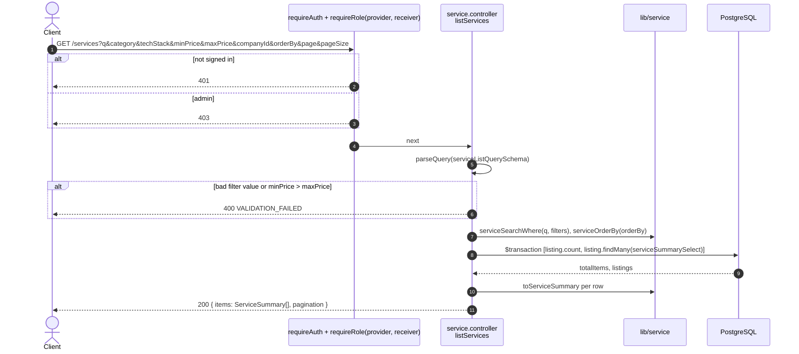
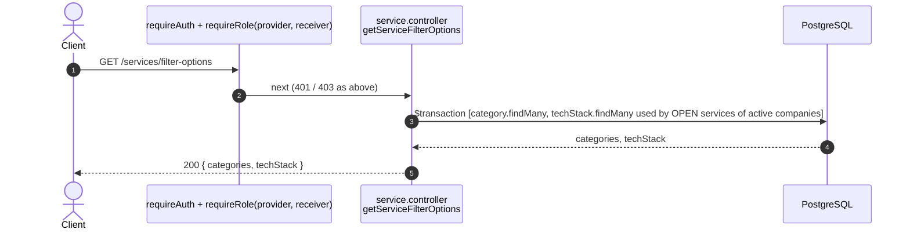
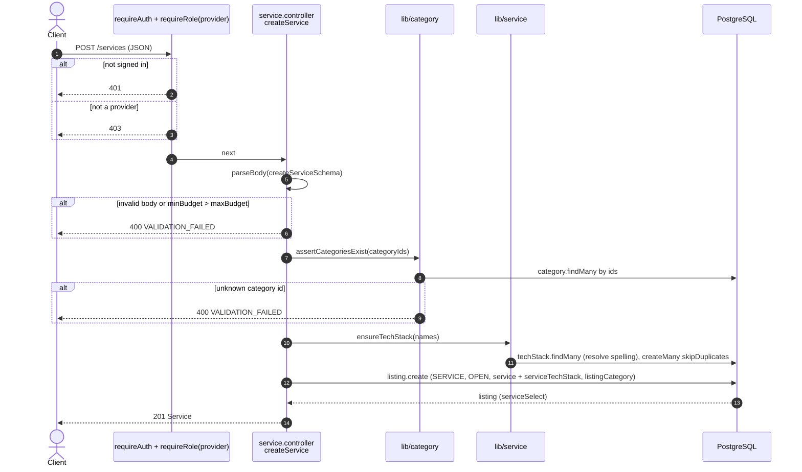
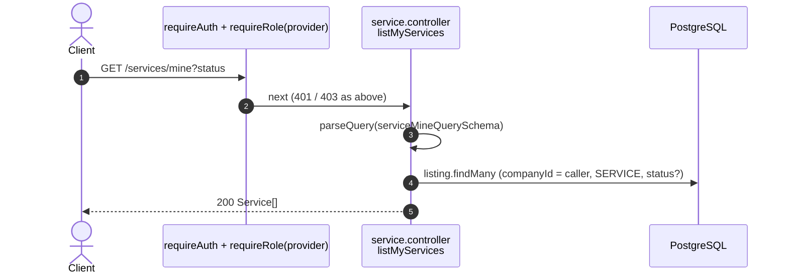
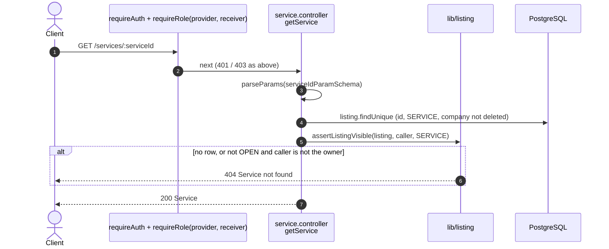
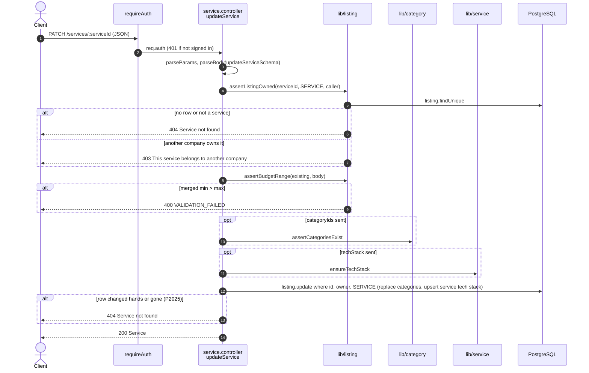
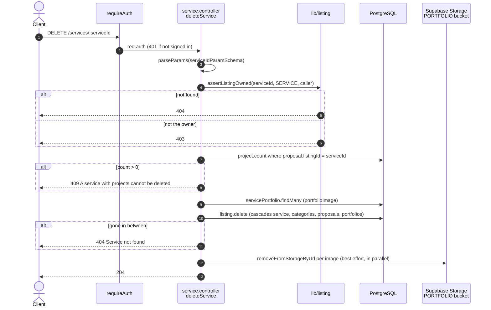

# Service endpoints (`/services`)

Source: `apps/api/src/routes/service.routes.ts`,
`apps/api/src/controllers/service.controller.ts`.
Back to the [index](README.md).

A service is a `listing` row with `listingType = SERVICE` plus a `service` row.
Every route needs `requireAuth`.

| Method | Path                       | Guards             | Success                         |
| ------ | -------------------------- | ------------------ | ------------------------------- |
| GET    | `/services`                | provider, receiver | 200 `{ items, pagination }`     |
| GET    | `/services/filter-options` | provider, receiver | 200 `{ categories, techStack }` |
| POST   | `/services`                | provider           | 201 Service                     |
| GET    | `/services/mine`           | provider           | 200 Service[]                   |
| GET    | `/services/:serviceId`     | provider, receiver | 200 Service                     |
| PATCH  | `/services/:serviceId`     | auth, owner        | 200 Service                     |
| DELETE | `/services/:serviceId`     | auth, owner        | 204                             |

## GET /services

US3-1. Search open services of active companies. Paged and sorted.

## GET /services/filter-options

T3.2.2. The choices for the search filters.

## POST /services

Create and publish a service. Listing, service, categories, and tech stack are
one nested write.

## GET /services/mine

The caller's own services, every status, newest first.

## GET /services/:serviceId

Any company reads an OPEN service of an active company. The owner reads its own
in any status. Everything else is 404.

## PATCH /services/:serviceId

T2.3.4 / T2.3.5. Owner only. Sent fields only. `categoryIds` and `techStack`
replace the whole set.

## DELETE /services/:serviceId

Hard delete. Refused when any project came from this service (US2-4).
Portfolio images are removed from storage after the rows are gone.

