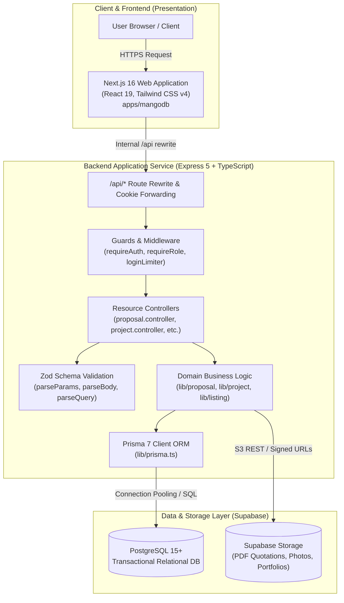
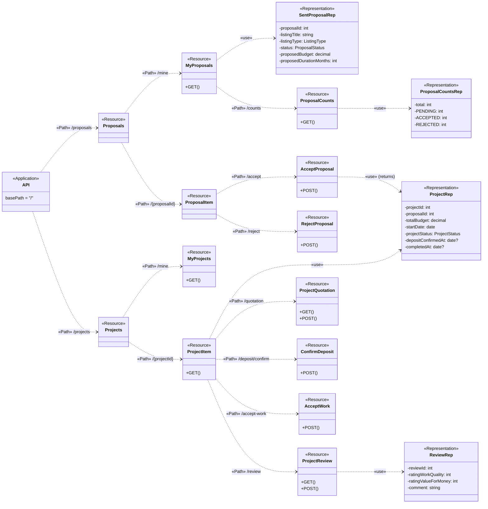
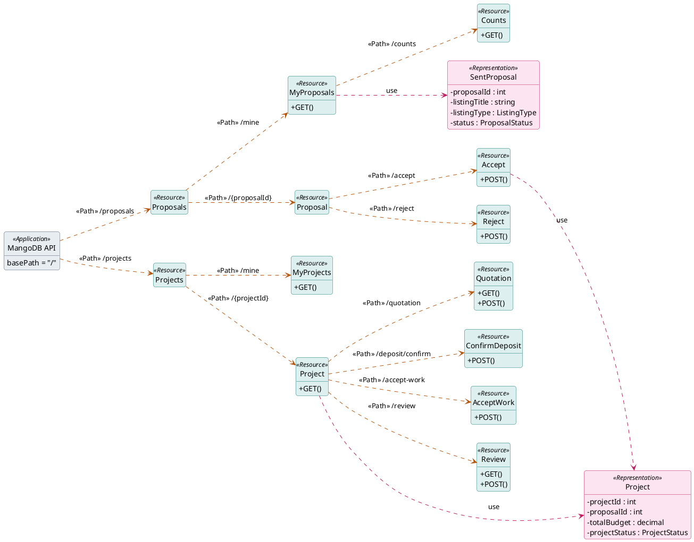
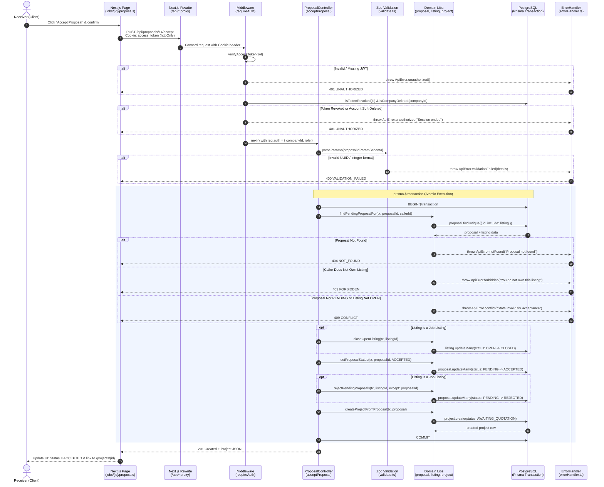

# System Architecture & API Design Report: MangoDB

This document provides the architectural specification for **MangoDB**, a B2B marketplace platform for IT services and job contracting. It covers:

1. **System Architecture & UML API Diagram** (Sparx Systems REST Profile)
2. **Sequence Diagram for Core Use Case** (US2-11: Accept Proposal & Initialize Project)
3. **Design Quality Evaluation** (Reusability, Maintainability, Scalability, Security)

---

## 1. System Architecture Overview

MangoDB follows a three-tier decoupled architecture designed for high cohesiveness, strong type safety, and clear boundaries:



---

## 2. UML API Diagram

The UML API Diagram below follows the **Sparx Systems REST Profile** standard commonly used in software engineering curriculum:

- `«Application»`: Represents the API root endpoint with `basePath = "/"`.
- `«Path»`: Connectors defining URI hierarchy segments.
- `«Resource»`: REST resource entity exposing standard HTTP verbs (`GET`, `POST`, `PATCH`, `DELETE`).
- `«Representation»`: JSON payload structures exchanged between client and server (`«use»` dependency).

The diagram focuses on the central business engine of MangoDB: **Proposals & Projects**.

### 2.1 Mermaid UML API Diagram



### 2.2 PlantUML Source (Exact Course Specification)



---

## 3. Sequence Diagram (Use Case US2-11: Accept Proposal)

This sequence diagram illustrates the complete end-to-end flow of the **Accept Proposal** operation (`POST /api/proposals/{proposalId}/accept`). It highlights how the platform verifies authentication, asserts authorization and ownership, isolates database mutations inside a strict ACID transaction, and standardizes errors.



---

## 4. Discussion of the UML API Diagram in terms of Design Quality

The architectural quality of the REST API is evaluated against four primary software quality attributes: **Reusability**, **Maintainability**, **Scalability**, and **Security**.

### 4.1 Reusability

1. **Shared Schema Representations (`packages/shared`)**:
    - Instead of defining disparate shapes across client and server, representations (`Project`, `SentProposal`, `CompanyProfile`, etc.) are declared once in `packages/shared` as single sources of truth.
    - Client-side data fetching hooks and backend controllers both bind directly to these types, ensuring compile-time contract compatibility and preventing wire format regressions.
2. **Uniform Resource Hierarchy & Polymorphic Proposals**:
    - Per ADR 0016, both job bidding (Provider bidding on Receiver's Job) and direct hire requests (Receiver hiring Provider's Service) reuse the same underlying `«Resource» Proposal` and state machine (`PENDING`, `ACCEPTED`, `REJECTED`).
    - Common pagination wrappers (`{ items: T[], pagination: { page, pageSize, total, totalPages } }`) and summary counters (`/counts`) are reused across all collection endpoints.
3. **Decoupled Business Services**:
    - The controllers delegate core mutations to reusable domain libraries (`lib/proposal.ts`, `lib/listing.ts`, `lib/project.ts`), making the business logic callable not only by HTTP handlers but also by asynchronous background jobs or automated test harnesses.

### 4.2 Maintainability

1. **Strict Separation of Concerns**:
    - The design neatly delineates **Paths** (URI routing in Express), **Resources** (HTTP verb dispatches), and **Representations** (DTOs). Routing (`*.routes.ts`), request parsing (`validate.ts`), business rules (`lib/*.ts`), and persistence (`prisma.ts`) are completely decoupled.
2. **Declarative Validation via Zod Schemas**:
    - All inbound payloads (path parameters, query filters, and JSON bodies) are validated through declarative schemas before reaching controller logic. If an API contract evolves, updating the schema updates input validation, documentation, and TypeScript types simultaneously.
3. **Normalized Error Envelope**:
    - All failures flow through a centralized `errorHandler` that outputs a predictable RFC-compliant JSON envelope:
        ```json
        {
            "error": {
                "code": "VALIDATION_FAILED",
                "message": "Invalid input",
                "details": [
                    {
                        "field": "proposedBudget",
                        "message": "Expected number, received string"
                    }
                ]
            }
        }
        ```
    - This prevents error format fragmentation and dramatically reduces frontend error-handling boilerplate.

### 4.3 Scalability

1. **Stateless API Design**:
    - The Express API maintains no server-side in-memory session states. Client authentication relies on self-contained JSON Web Tokens (JWT) carried in `httpOnly` secure cookies.
    - As traffic scales, additional API instances can be spun up behind a standard reverse proxy (e.g., Caddy/Nginx) without requiring session synchronization or sticky load balancing.
2. **Defensive Query Execution & Cursor/Offset Pagination**:
    - All collection resources (`/jobs`, `/services`, `/proposals/mine`, `/projects/mine`) mandate pagination parameters (`page`, `pageSize` with hard upper caps).
    - Unbounded queries (`SELECT *`) are banned. Prisma transactions bundle `.count()` and `.findMany()` with selective field projection (`select: { id, title, status }`), minimizing network bandwidth and database memory footprint.
3. **Static & Media Offloading**:
    - Large binary payloads (PDF quotations, project deliverables, company certificates) are stored directly in S3-compatible cloud buckets (Supabase Storage). The API only exchanges signed URLs and metadata, keeping backend network I/O lean.

### 4.4 Security

1. **Defense-in-Depth Middleware Pipeline**:
    - Requests traverse a multi-stage security pipeline prior to business logic execution:
        1. **`loginLimiter`**: Rate-limits authentication attempts (e.g., max 10 failed logins per email/IP in 15 mins) to prevent brute-force attacks.
        2. **`requireAuth`**: Validates JWT cryptographic signature, expiry (`exp`), revocation status via `isTokenRevoked(jti)`, and verifies the company has not been soft-deleted (`isCompanyDeleted`).
        3. **`requireRole('provider' | 'receiver' | 'admin')`**: Enforces strict Role-Based Access Control (RBAC).
2. **No Relying on Client-Supplied Identifiers (IDOR Mitigation)**:
    - For sensitive user actions (such as fetching one's proposals or creating a listing), the platform reads the authenticated `companyId` directly from the validated token claims (`req.auth.companyId`), never trusting client-supplied URL query or body IDs.
    - Resource access enforces strict ownership checks in domain helpers (e.g., ensuring `proposal.listing.companyId === callerId`).
3. **Cross-Site Scripting (XSS) & CORS Protection**:
    - Access tokens are encapsulated in `httpOnly`, `SameSite=Lax`, `Secure` cookies inaccessible to JavaScript running in the browser.
    - The Next.js frontend proxies `/api/*` calls server-to-server, rendering external cross-origin requests (`CORS`) unnecessary and neutralizing credential leakage vectors.
