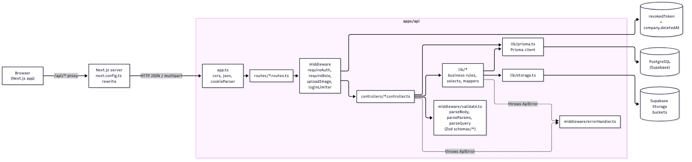
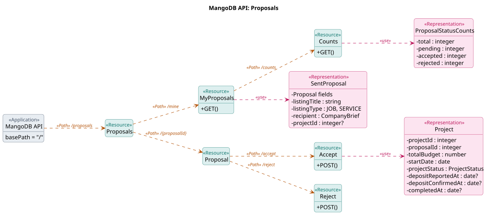
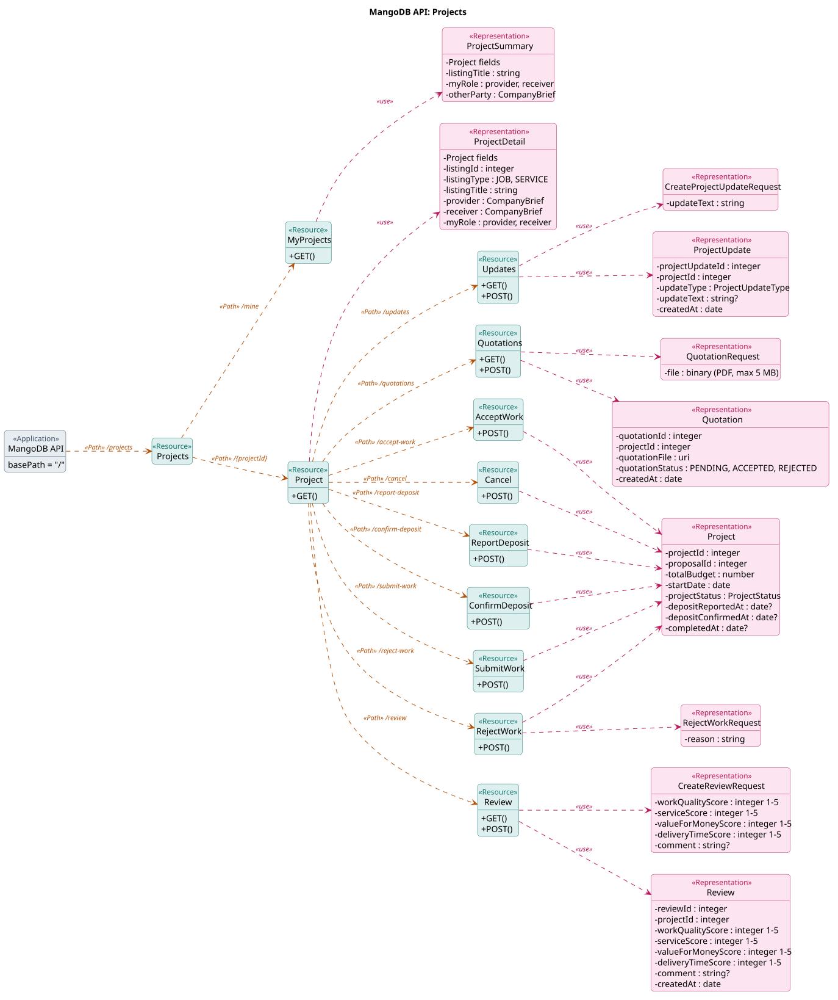
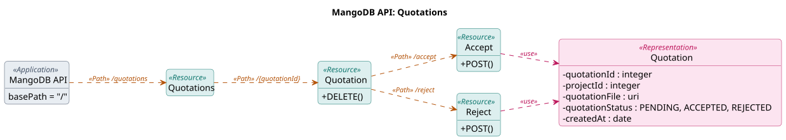
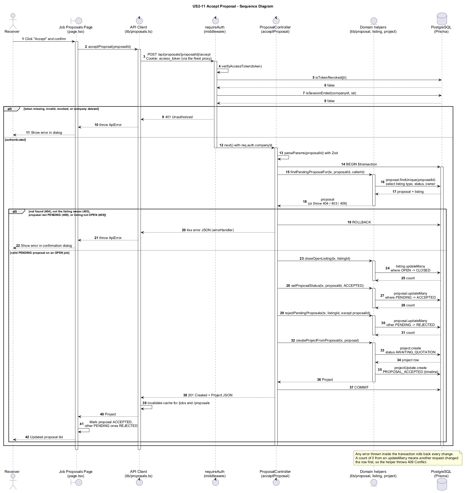

# System Architecture & API Design Report: MangoDB

This document provides the architectural specification for **MangoDB**, a B2B marketplace platform for IT services and job contracting. It covers:

1. **System Architecture Overview**
2. **UML API Diagram** (Sparx Systems REST Profile)
3. **Sequence Diagram** (US2-11: Accept Proposal)
4. **Discussion of the UML API Diagram in terms of Design Quality** (Reusability, Maintainability, Scalability, Security)

---

## 1. System Architecture Overview

MangoDB is a Next.js 16 web app (React 19, Tailwind CSS v4), an Express 5 API in TypeScript with Prisma 7, and Supabase for PostgreSQL and file storage. The diagram shows the layers a request passes through; arrows point from caller to callee.



---

## 2. UML API Diagram

The diagrams follow the Sparx Systems REST profile from the lecture (`«Application»`, `«Path»`, `«Resource»`, `«Representation»`). The full API, all 72 endpoints, is [`mangodb-api.svg`](../api/uml/mangodb-api.svg). The three routers this document discusses:







---

## 3. Sequence Diagram (US2-11: Accept Proposal)

`POST /proposals/{proposalId}/accept`, from the click to the database. Source: [`accept-proposal-implementation.puml`](../uml/sequence/accept-proposal-implementation.puml).



---

## 4. Discussion of the UML API Diagram in terms of Design Quality

The architectural quality of the REST API is evaluated against four primary software quality attributes: **Reusability**, **Maintainability**, **Scalability**, and **Security**, referencing the UML API diagrams directly.

### 4.1 Reusability

1. **Polymorphic Proposal Resource (ADR 0016)**:
    - On the diagram, a single `«Resource» Proposals` serves both job bids (Provider bidding on Receiver's Job) and hire requests (Receiver hiring Provider's Service). Both follow the identical lifecycle (`PENDING` $\rightarrow$ `ACCEPTED` / `REJECTED`).
    - One `«Representation» Project` is returned uniformly across multiple lifecycle actions: `POST /proposals/{proposalId}/accept`, `POST /projects/{projectId}/confirm-deposit`, `POST /projects/{projectId}/accept-work`, and `POST /projects/{projectId}/cancel`.
2. **Shared Schema Representations (`packages/shared`)**:
    - Instead of defining disparate shapes across client and server, all representations (`Project`, `SentProposal`, `CompanyBrief`, etc.) are declared once in `packages/shared` as single sources of truth.
    - Both `apps/api` and `apps/mangodb` import these shared types, ensuring compile-time contract compatibility and preventing wire format regressions.
3. **Uniform Collection Envelopes**:
    - Every paged list answers with the same `{ items, pagination: { page, pageSize, totalItems, totalPages } }` body, built by one helper (`lib/pagination.ts`).

### 4.2 Maintainability

1. **One Router per Top-Level «Path» & Clean URI Hierarchy**:
    - The diagram assigns each resource domain its own top-level `«Path»` (`/proposals`, `/projects`, `/quotations`).
    - Sub-resources that identify a distinct entity do not nest parents needlessly: for example, `/quotations/{quotationId}` is a top-level resource path rather than nested under `/projects/{projectId}/quotations/{quotationId}` (conventions §2.4).
2. **Declarative Validation via Zod Schemas**:
    - All inbound payloads (path parameters, query filters, and JSON bodies) are validated by Zod schemas (`parseParams`, `parseQuery`, `parseBody`) before the handler uses them.
    - The OpenAPI comments and the `packages/shared` types are kept by hand next to the schema, so a contract change edits all three in the same PR.
3. **Normalized Error Envelope**:
    - All failures flow through one `errorHandler`, which answers in the same JSON envelope (`ApiErrorResponse` in `packages/shared`):
        ```json
        {
            "error": {
                "code": "VALIDATION_FAILED",
                "message": "Request body is invalid",
                "details": [
                    {
                        "field": "proposalBudget",
                        "message": "Required"
                    }
                ]
            }
        }
        ```
    - Consistent HTTP status codes keep errors distinct: 400 (schema/validation rejection), 401 (not signed in or session ended), 403 (wrong role or permission), 404 (missing entity or outsider access), 409 (state conflict), and 429 (rate limit exceeded).

### 4.3 Scalability

1. **Stateless API Design**:
    - The Express API keeps no session in memory. A session is a JWT in an `httpOnly` cookie, and logged-out tokens are stored in the database (`revokedToken`), so any API instance can check any request.
    - So more API instances can run behind a reverse proxy (e.g., Caddy) with no session sync. One exception: `loginLimiter` counts failed logins in each process's memory (`middleware/rateLimit.ts`), so two instances would each keep their own count until it moves to a shared store.
2. **Bounded Lists with Offset Pagination**:
    - Collection resources (`/jobs`, `/services`, `/proposals/mine`, `/projects/mine`) take `page` and `pageSize`: 12 rows by default, at most 50 (`schemas/common.schema.ts`), so one request cannot pull a whole table.
    - Each list runs `.count()` and `.findMany()` in one `prisma.$transaction`, selecting only the fields it returns. Short per-project lists (quotations, timeline) are plain arrays.
3. **Files Stay Out of the Database**:
    - Quotation PDFs and images (profile, portfolio, certificate) live in Supabase Storage; the database keeps only their URLs.
    - An upload passes through the API once (multer holds it in memory, up to 5 MB), and reads go straight to storage: public URLs for images, short-lived signed URLs for quotation PDFs.

### 4.4 Security

1. **Defense-in-Depth Middleware Pipeline**:
    - Each route names its guards in `routes/*.routes.ts`. Most take `requireAuth`; sign-up, sign-in and a few public reads (`/categories`, `/portfolios`) skip it. The guards:
        1. **`loginLimiter`** (the two login routes only): Allows 10 failed sign-ins per email in 15 minutes, then answers 429 (`middleware/rateLimit.ts`). It counts per email, not per IP, because every request arrives through the Next proxy, which does not pass the visitor's IP on.
        2. **`requireAuth`**: Validates the JWT signature and expiry, checks the token was not logged out (`isTokenRevoked(jti)`), and checks the session has not ended (`isSessionEnded`: company deleted, or credentials changed after the token was issued).
        3. **`requireRole('provider' | 'receiver' | 'admin')`**: Enforces strict Role-Based Access Control (RBAC).
2. **Server-Extracted Identity & 404 for Outsiders**:
    - Sensitive operations read the caller's company identity directly from cryptographically validated token claims (`req.auth.companyId`), preventing IDOR attacks from spoofed request bodies or URL parameters.
    - Outsiders calling a resource they do not participate in receive a 404 (or 403), ensuring callers cannot probe private project data or verify the existence of confidential listings.
3. **Cookie Security, CORS & Cross-Site Guard**:
    - Access tokens are kept in `httpOnly`, `SameSite=Lax` cookies (`Secure` in production), so JavaScript in the browser cannot read them.
    - The browser only talks to Next.js, which proxies `/api/*` to the API, so no cross-origin call is needed. The API still allows only `FRONTEND_URL` through CORS and refuses cross-site writes (`refuseCrossSiteWrites`, using the browser's `Sec-Fetch-Site` header).
