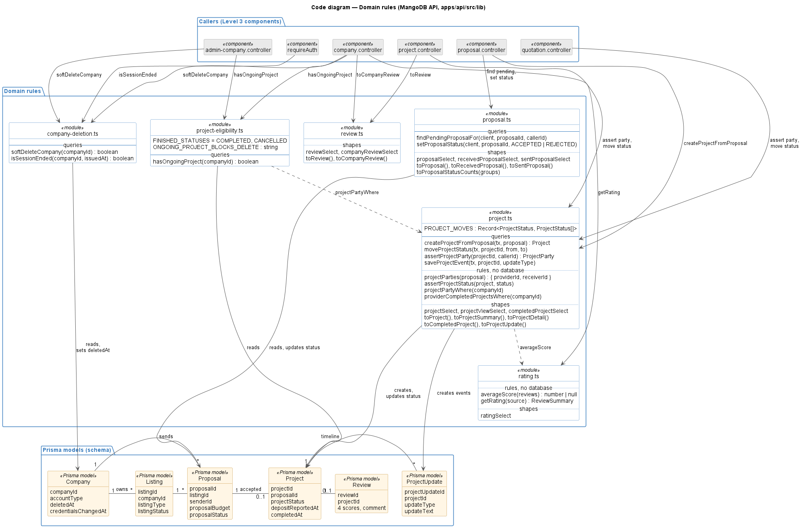
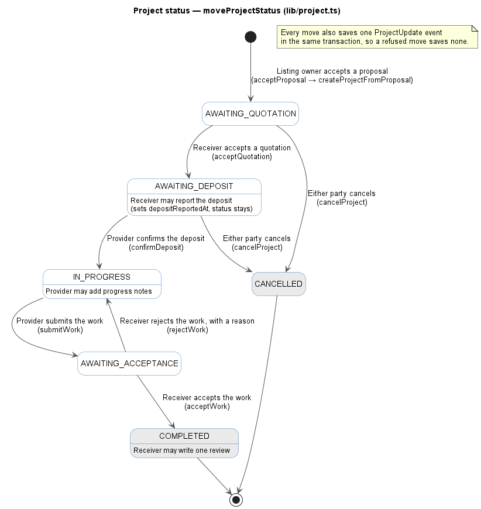

# MangoDB — C4 diagrams

Level 1 (System Context), Level 2 (Container), Level 3 (Component, for
the API and the web application) and Level 4 (Code, for the API's domain
rules) of the [C4 model](https://c4model.com), written in
[C4-PlantUML](https://github.com/plantuml-stdlib/C4-PlantUML) and plain
PlantUML. The `.puml` files are the source; the `.png` files are rendered
from them. Level 4 is drawn from the code on `main` at `9b4daa9`.

To re-render after a change (PlantUML 1.2024+ has C4 in its standard
library, so no network is needed):

```bash
java -jar plantuml.jar -tpng -charset UTF-8 docs/test-plan/c4/*.puml
```

## Level 1 — System Context

Source: [`context.puml`](context.puml)


- A company with account type `BOTH` acts as Provider and Receiver.
- MangoDB sends no email and has no outside sign-in provider
  ([ADR 0012](../../adr/0012-no-forgot-password.md)).

## Level 2 — Container

Source: [`container.puml`](container.puml)


- **`packages/shared`** is not a container. It is a TypeScript package of
  request and response types that both the web app and the API import at
  build time.
- **Why the proxy:** the browser only talks to the web app, so the session
  cookie works with no CORS setup, even when web and API run on different
  hosts (`apps/mangodb/next.config.ts`).
- **Prisma CLI** (migrations, Studio) uses the direct `DIRECT_URL`
  connection, not the pooled one (`apps/api/prisma.config.ts`).

## Level 3 — Component (API)

Source: [`component.puml`](component.puml)


- **One request, in order:** pipeline → router → guards and Zod validation
  (declared per route) → controller → domain rules / Prisma. A thrown
  `ApiError` goes back to the pipeline's error handler.
- **Controllers are grouped by feature.** Each box covers the controller
  files named under it, and the routers that call them.
- **Controllers and domain rules both query Prisma.** For a multi-step write
  (accepting a proposal, moving a project's status) the controller opens the
  transaction and calls the `lib/` steps inside it. Level 4 below shows which.
- **Guards cost two reads per signed-in request:** the revoked-token list
  and whether the company was deleted.
- **Not shown:** small `lib/` mappers and select shapes, `env.ts`, and the
  Swagger docs at `/api-docs`.

## Level 4 — Code (API domain rules)

Source: [`code-domain.puml`](code-domain.puml)

This zooms into the **Domain rules** box of the API component diagram.
C4-PlantUML has no Level 4 macros, so this is a plain UML class diagram.



- **A box is a file, not a class.** Each `<<module>>` is one file in
  `apps/api/src/lib` with its exported functions. The code has no classes
  here, only functions and types.
- **Three kinds of export:** _queries_ read or write the database, _rules_
  decide something with no database call, and _shapes_ are Prisma `select`
  objects and the `to…()` functions that turn a row into the wire type.
- **Arrows to a model are this module's own reads and writes.** Controllers
  also query models with the shapes from `review.ts` and `rating.ts`; those
  queries are not drawn.
- **`projectParties` is the one Provider/Receiver rule** (ADR 0016).
  `projectPartyWhere`, `providerCompletedProjectsWhere`, `toCompanyReview` and
  `rating.ts` each apply the same rule as a filter or a mapping.
- **Not shown:** `lib/quotation.ts` (same party check for quotations),
  `lib/listing.ts` (`closeOpenListing`, `rejectPendingProposals`, which
  `acceptProposal` also calls), and the `ApiError` and `company-profile`
  helpers every module imports.

### Project status flow

Source: [`project-status.puml`](project-status.puml)



- **`PROJECT_MOVES` in `lib/project.ts` is the whole table** (ADR 0015).
  `moveProjectStatus` refuses any other move with 409, and so does a move
  that another request made first.
- **Who may move it is the endpoint's check,** against `myRole` from
  `assertProjectParty`. The labels name the endpoint and the role.
- **Reporting the deposit is not a move.** It sets `depositReportedAt` and
  the status stays `AWAITING_DEPOSIT` until the Provider confirms.

## Level 3 — Component (web application)

Source: [`component-web.puml`](component-web.puml)


- **Almost everything runs in the browser.** The pages are client
  components. The Next server serves them and runs the one server-side part
  shown here: the `/api/*` rewrite.
- **One way out:** every request goes resource module → `apiFetch` → proxy.
  Nothing else calls `fetch`.
- **The cache sits beside the client, not in front of it.** Resource modules
  wrap their GETs in `cachedGet` and call `invalidateAfter` after a write.
  Login and logout clear it in every open tab.
- **The access gate is for display only.** It decides what a page shows; the
  API's guards are what actually refuse a request.
- **Not shown:** small helpers (`dates`, `money`, `images`, `profileLinks`)
  and the `@mangodb/shared` types, which the resource modules and components
  import.

## Where the containers run

This is deployment, not part of the two diagrams above.

| Container       | Hosted alpha          | Self-hosted (`docker-compose.yml`)          |
| --------------- | --------------------- | ------------------------------------------- |
| Web application | Vercel                | `web` service, behind Caddy (HTTPS)         |
| API             | Render, free web plan | `api` service, no public port               |
| Database, files | Supabase              | Supabase (compose keeps no data of its own) |
